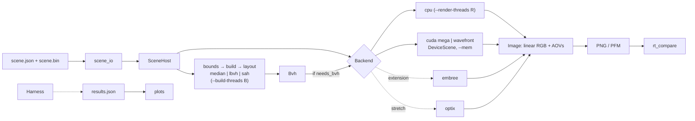
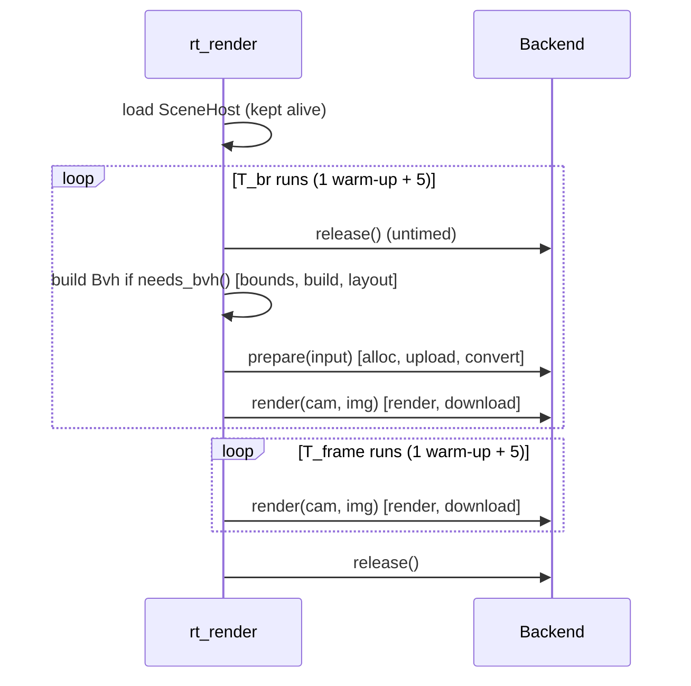
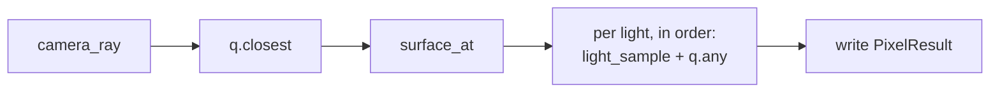
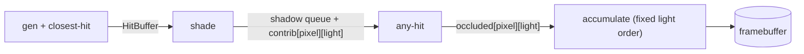

# Architecture

How the renderer is structured, how data flows, and why. Types, signatures, and numeric rules live in [INTERFACES.md](INTERFACES.md). The directory layout is in [REPO_SKELETON.md](REPO_SKELETON.md). Scope tags (Core / Extension / Stretch) follow [ROADMAP.md](ROADMAP.md#scope).

## Design principles

1. **One shared render core.** Math, intersection, traversal, and shading are header-only `RT_HOSTDEV` code called by every backend. This guarantees **consistency**, so CPU/GPU differences point to backend or compiler issues. It does **not** guarantee correctness: a shared bug makes every backend agree. Correctness comes from independent checks (analytic cases, a double-precision oracle, brute-force comparison) written by a different member than the code's author. See the [quality protocol](BENCHMARKING.md#quality-protocol).
2. **Owning storage vs views.** `SceneHost` and `Bvh` own host arrays. `DeviceScene` owns device arrays. Code that renders sees only POD views (`Scene`, `BvhView`) passed by value. Upload copies each array separately and builds a view of device pointers.
3. **Type-agnostic BVH.** Builders see per-primitive bounds and centroids. Spheres and triangles differ only by the `PrimRef` type bit.
4. **Frozen numeric rules.** Intervals, tie-breaks, NaN handling, shadow-ray construction, and light accumulation order are specified once in INTERFACES. Same-backend output is then bit-reproducible, and BVH-vs-brute-force output is identical.
5. **Backends behind one interface.** Backends that don't use our BVH (Embree, OptiX) never trigger a build of it.
6. **Measure directly.** Each timing quantity has its own wall-clock timer. Components explain it but aren't assumed to sum to it.

## Data flow



### Stages and timing

| Stage | Owner | Component | In T_app | In T_br | In T_frame |
|---|---|---|---|---|---|
| Parse args, load files | Po | `args`, `load` | Yes | No | No |
| CUDA context init | Mikail | `cuda_init` | Yes | No | No |
| Primitive bounds/centroids | Jett | `bounds` | Yes | Yes | No |
| BVH method | Jett | `build` | Yes | Yes | No |
| Layout conversion, collapse, depth cap | Jett | `layout` | Yes | Yes | No |
| Embree/OptiX internal build | Po / Mikail | `convert` | Yes | Yes | No |
| Device allocation | Mikail | `alloc` | Yes | Yes | No |
| Upload | Mikail | `upload` | Yes | Yes | No |
| Render | Mikail, Arek | `render` | Yes | Yes | Yes |
| Download image + AOVs | Mikail | `download` | Yes | Yes | Yes |
| Write PNG/PFM | Po | `write` | No | No | No |

Definitions: [BENCHMARKING.md](BENCHMARKING.md#timing-quantities).

## Modules

| Module | Owner | Responsibility | Tier |
|---|---|---|---|
| `core` | Arek | vec3, Ray, AABB, slab test, `RT_HOSTDEV` | Core |
| `scene` | Po | `SceneHost`, JSON/`.bin` IO, hash, generator | Core |
| `camera` | Jett | Camera model and `camera_ray` | Core |
| `bvh` | Jett | Bounds stage, median, LBVH, layout conversion, validator; SAH | Core; SAH Extension |
| `trace` | Mikail | Intersection, closest/any-hit traversal, brute force | Core |
| `shade` | Arek | Lambert, shadow rays, accumulation; Blinn-Phong | Core; Blinn-Phong Extension |
| `image` | Po | `Image`, PNG/PFM IO | Core |
| `cpu` | Po | CPU backend | Core |
| `gpu` | Mikail, Arek | `DeviceScene`, megakernel; memory modes; wavefront | Core; modes and wavefront Extension |
| `embree` | Po | Embree backend | Extension |
| `optix` | Mikail, Arek | OptiX backend | Stretch |
| `bench` | Arek | Timers, harness, results | Core |

Dependencies point one way: `core` ← `scene`, `camera`, `bvh` ← `trace` ← `shade` ← backends ← apps.

## Backend interface

Signature in [INTERFACES.md](INTERFACES.md#7-backend-interface). Lifecycle:



The last `Bvh` built stays alive (and unmodified) for the T_frame runs, as the `system` memory mode requires.

| `--backend` | Uses our BVH | Variants | Tier |
|---|---|---|---|
| `cpu` | Yes | `--render-threads R` | Core |
| `cuda` | Yes | `--pipeline mega` (Core) / `wavefront` (Extension); `--mem` | Core |
| `embree` | No | `--render-threads R` | Extension |
| `optix` | No | | Stretch |

## GPU pipelines

Both call the same shared functions and follow the same [accumulation order](INTERFACES.md#accumulation-order-frozen).

### Megakernel (Core)



`q` is the compile-time [tracing query](INTERFACES.md#tracing-queries): `BvhQuery` normally, `BruteQuery` for `--bvh none`. The CPU backend and the Embree/OptiX backends run the same `render_pixel` template with their own query type.

One thread per pixel. Scalar state stays in registers where the compiler allows it. The traversal stack is a dynamically indexed array, so it typically lives in **local memory**, which is cached in L1 but slower than registers. Check `-Xptxas -v` and Nsight Compute for spills and local-memory traffic rather than assuming on-chip state. Shared-memory or short-stack variants are tuning options at G3.

### Wavefront (Extension E5)



- Queues are filled with atomic counters, so their order varies between runs.
- Each entry carries `(pixel, light)` and writes to a fixed slot. The accumulate kernel sums slots in light order. The final image is therefore deterministic even though queue order isn't.

### Tradeoffs

| Factor | Megakernel | Wavefront |
|---|---|---|
| Inter-stage traffic | None beyond local-memory stack traffic | Idealized estimate: ~100 B × (1+L) per pixel, a few hundred MB per 1080p frame. At peak bandwidth that's ~0.1 ms on Hopper and ~1–2 ms on the 4070 Laptop. Real cost must be profiled. |
| Registers / occupancy | Higher pressure | Lower per kernel |
| Divergence | Mixed stages and primitive types within a warp | Uniform work per kernel |
| Per-stage timing | Profiler only | `cudaEvent` per kernel |
| Code | ~80–120 lines of glue | ~300–500 lines |

For direct lighting only, which is faster is an open question. It's measured only if E5 runs.

## GPU memory modes

`--mem explicit` is Core and the only mode on the laptop. `managed` and `system` are Extension E1, GH node only. Only scene and BVH arrays follow `--mem`. Framebuffers, AOVs, and wavefront queues always use `cudaMalloc`.

| Mode | Allocation | `upload` component | Notes |
|---|---|---|---|
| `explicit` | `cudaMalloc` per array | `cudaMemcpy` per array | Core |
| `managed` | `cudaMallocManaged`; CPU writes first | Optional `cudaMemPrefetchAsync`; `cudaMemAdvise` options | Placement depends on prefetch and advice |
| `system` | Fresh `mmap` host pages per preparation | Host memcpy into the fresh pages (CPU first touch) | GPU reads host memory over NVLink-C2C. Pages may migrate with repeated access, so T_frame records per-frame times. |
| `system-reuse` | None: views into persistent `SceneHost`/`Bvh` | None | Separate experiment (`geometry_reused: true`), not a T_br result for `system` |

Recording requirements: [BENCHMARKING.md](BENCHMARKING.md#memory-mode-protocol-extension-e1-gh-node-only). Unsupported modes fail at startup with a clear message.

## CLI

```
rt_render --scene s.json --backend cpu|cuda|embree|optix --bvh none|median|lbvh|sah \
          --build-threads B --render-threads R \
          --pipeline mega|wavefront --mem explicit|managed|system|system-reuse \
          --mem-advice none|preferred-gpu|read-mostly --prefetch on|off \
          --mode app|prepared --runs 5 --width W --height H \
          --shade lit|normal --aov primid,lightmask --out img.png --pfm img.pfm --results r.json
```

`--bvh none` uses brute force (testing only). Camera overrides (Jett) are set in C3: `--cam-pos`, `--cam-look`, `--cam-vfov`.

| App | Owner | Purpose |
|---|---|---|
| `rt_render` | Mikail (main), all | Render and time a scene |
| `rt_gen` | Po | Seeded generator |
| `rt_compare` | Po | Image and AOV comparison |
| `scene_dump` | Po | Print a parsed scene and its hash |
| `obj2bin` | Jett | OBJ/MTL → `.bin` (Extension E6) |

## References

- Jacco Bikker, "How to build a BVH" series, jacco.ompf2.com.
- PBRT v4, pbr-book.org: Ch. 6 (watertight triangle test, sphere quadratic, ray-box robustness), Ch. 7 (BVH, SAH, LBVH), floating-point error.
- Karras 2012, "Maximizing Parallelism in the Construction of BVHs, Octrees, and k-d Trees".
- Woop, Benthin, Wald 2013, "Watertight Ray/Triangle Intersection".
- Wald 2007, "On Fast Construction of SAH-based BVHs".
- Aila & Laine 2009, "Understanding the Efficiency of Ray Traversal on GPUs".
- Laine, Karras & Aila 2013, "Megakernels Considered Harmful".
- Ray Tracing Gems I, Ch. 6, "A Fast and Robust Method for Avoiding Self-Intersection".
- CUDA C++ Programming Guide: local memory, unified memory.
- TACC Vista user guide, docs.tacc.utexas.edu/hpc/vista.
- Embree 4 docs; OptiX SDK samples.
