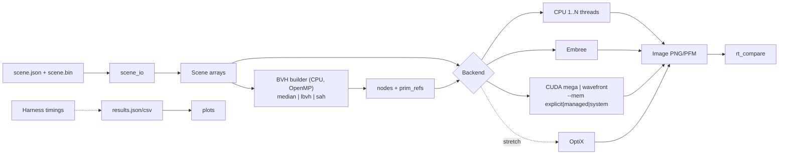
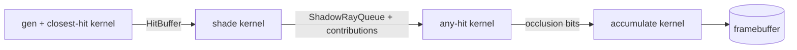

# Architecture

How the renderer is structured, how data flows, and why. Exact types and signatures live in [INTERFACES.md](INTERFACES.md). The directory layout is in [REPO_SKELETON.md](REPO_SKELETON.md).

## Design principles

1. **One shared core.** Math, intersection, traversal, and shading are header-only `__host__ __device__` code. The CPU reference, Embree shading, the megakernel, and the wavefront kernels all call the same functions. CPU/GPU image differences then point to real bugs, and the "same rendering rules" requirement holds by construction.
2. **Flat arrays everywhere.** The scene and BVH are plain arrays of POD structs. They copy to the GPU with a single memcpy (or are read in place under `--mem=system`).
3. **Type-agnostic BVH.** The builder sees only per-primitive AABBs and centroids. Spheres and triangles are distinguished by a type tag in `PrimRef`.
4. **Backends behind one interface.** CPU, Embree, CUDA, and OptiX are interchangeable at runtime. OptiX stays isolated so it can be added or dropped without touching anything else.
5. **Deterministic rendering.** 1 sample per pixel, primary + shadow rays only, no randomness at render time. Outputs are comparable pixel by pixel within a float tolerance.
6. **Measure everything.** Every stage reports timing to the harness. Cold and warm runs are both recorded.

## Data flow



Stage ownership and timing:

| Stage | Owner | Timed as | Counted in "total"? |
|---|---|---|---|
| Load scene files | Po | `load` | No, reported separately |
| BVH build (CPU) | Jett | `build` | Yes |
| Upload to GPU | Mikail | `upload` | Yes |
| Render | Mikail (visibility), Arek (shading) | `render` (+ per stage in wavefront) | Yes |
| Download image | Mikail | `download` | Yes |
| Write PNG/PFM | Po | `write` | No |

Embree builds its own BVH. Its `build` time is Embree's build, reported in the best-possible tier only. See [BENCHMARKING.md](BENCHMARKING.md).

## Modules

| Module | Owner | Responsibility |
|---|---|---|
| `core` | Arek | vec3, Ray, AABB, color, `RT_HOSTDEV` macro |
| `scene` | Po | Scene struct, JSON + `.bin` IO, generator |
| `camera` | Jett | Camera model, ray generation, JSON + CLI overrides |
| `bvh` | Jett | Builders (median, LBVH, SAH), validator, SAH cost metric |
| `trace` | Mikail | Sphere/triangle intersection, closest-hit and any-hit traversal |
| `shade` | Arek | Lambert + Blinn-Phong, lights, shadow-ray generation, accumulation |
| `cpu` | Po | Single- and multithread CPU backend |
| `embree` | Po (Jett backup) | Embree backend (Extended) |
| `gpu` | Mikail, Arek | DeviceMemory, megakernel, wavefront (Arek: queues, shade, accumulate) |
| `optix` | Mikail, Arek | OptiX backend (Stretch) |
| `bench` | Arek | Timers, harness, results output |

Dependencies point downward only: `core` ← `scene`, `camera`, `bvh` ← `trace` ← `shade` ← backends ← apps.

## Backend interface

```cpp
struct Backend {
  virtual ~Backend() = default;
  // Upload/convert scene + BVH. Embree/OptiX build their own structures here.
  virtual void prepare(const Scene& scene, const Bvh& bvh, Timings& t) = 0;
  // Render one frame. Must be callable repeatedly for warm runs.
  virtual void render(const Camera& cam, Image& out, Timings& t) = 0;
  virtual const char* name() const = 0;
};
```

| `--backend` | Variants | Tier |
|---|---|---|
| `cpu` | `--threads N` | Controlled |
| `embree` | `--threads N` | Best-possible (Extended) |
| `cuda` | `--pipeline mega\|wavefront`, `--mem explicit\|managed\|system` | Controlled (best variant also used in best-possible) |
| `optix` | none | Best-possible (Stretch) |

## GPU pipelines

Both pipelines call the same `traverse_closest`, `traverse_any`, and `shade` functions. They differ only in how work is scheduled.

### Megakernel (built first)


One thread per pixel. All intermediate state lives in registers. About 80–120 lines of glue given the shared functions. It mirrors OptiX's raygen structure, so it's the fair CUDA counterpart in an RT-core comparison.

### Wavefront (built second, Extended)



Each stage is a separate kernel processing all rays. Global-memory buffers connect stages. Atomic counters fill queues, and compaction drops primary rays that missed. Based on Laine, Karras & Aila 2013. About 300–500 lines.

### Performance factors

| Factor | Megakernel | Wavefront |
|---|---|---|
| Inter-stage memory traffic | None (registers) | ~100 B × (1+L) per pixel, a few hundred MB per 1080p frame. ~0.1 ms on H100 (~3–4 TB/s), ~1–2 ms on 4070 Laptop (~256 GB/s) |
| Register pressure / occupancy | High: stack + shading + light loop in one kernel | Low per kernel: more resident warps, better latency hiding |
| Divergence | Threads in a warp at different stages; mixed sphere/triangle code | Uniform work per kernel; queues can be compacted or sorted |
| Launch overhead | 1 launch | 4–5 launches, ~5 µs each (negligible) |
| Typically wins for | Simple shading, primary + shadow rays | Complex materials, multiple bounces, uneven work |

For our workload (direct lighting only) the winner is not obvious. It is an open study question, measured in [BENCHMARKING.md](BENCHMARKING.md).

### Development impact

| | Megakernel | Wavefront |
|---|---|---|
| Glue code | ~80–120 lines, 1 kernel | ~300–500 lines, 4–5 kernels + queue structs |
| Time to first image | Days after traversal works | Every stage must work first |
| Per-stage timing | Only via Nsight profiles or in-kernel clocks | Free, `cudaEvent` around each kernel |
| Matches OptiX structure | Yes | No |
| Path to reflections | Bounded loop per thread (more divergence) | Loop stages with compaction |
| Interaction with `--mem` | Scene/BVH only | Scene/BVH only; queues always `cudaMalloc` |

Wavefront is the first cut candidate if time runs short.

## GPU memory modes

Selected at runtime with `--mem`. Only scene and BVH data follow this flag. Pipeline buffers are always `cudaMalloc`.

| Mode | Allocation | Upload | Where |
|---|---|---|---|
| `explicit` | `cudaMalloc` | `cudaMemcpy` (timed) | Laptop and GH200 |
| `managed` | `cudaMallocManaged` | Optional `cudaMemPrefetchAsync` (timed); otherwise on-demand migration | GH200 only (Extended) |
| `system` | Plain `malloc` / `std::vector` | None; GPU reads CPU memory via ATS over NVLink-C2C | GH200 only (Extended) |

Unsupported modes fail at startup with a clear error. Unified memory on the laptop (WSL2) is out of scope. A `DeviceMemory` layer hides the mode from the rest of the code.

## CLI

```
rt_render --scene s.json --backend cpu|embree|cuda|optix --pipeline mega|wavefront \
          --mem explicit|managed|system --bvh median|lbvh|sah --threads N \
          --width W --height H --runs 5 --out img.png --results r.json
```

Camera overrides (owned by Jett) are added on top: e.g. `--cam-pos`, `--cam-look`, `--cam-fov`. Final names are set in Task 3.

| App | Owner | Purpose |
|---|---|---|
| `rt_render` | Mikail (main), all | Render + time a scene |
| `rt_gen` | Po | Seeded scene generator |
| `rt_compare` | Po | Image diff, metrics, heatmap |
| `scene_dump` | Po | Print a parsed scene |
| `obj2bin` | Jett | Convert OBJ/MTL to the binary format (Extended) |

## References

- Jacco Bikker, "How to build a BVH" series, jacco.ompf2.com. Practical BVH, binned SAH, GPU traversal.
- PBRT v4, pbr-book.org. Ch. 7 (BVH, SAH), Ch. 6 (triangle intersection), floating-point error and robust offsets.
- Karras 2012, "Maximizing Parallelism in the Construction of BVHs, Octrees, and k-d Trees". LBVH.
- Wald 2007, "On Fast Construction of SAH-based BVHs". Binned SAH.
- Aila & Laine 2009, "Understanding the Efficiency of Ray Traversal on GPUs".
- Laine, Karras & Aila 2013, "Megakernels Considered Harmful". Wavefront.
- Ray Tracing Gems I (free PDF), Ch. 6, "A Fast and Robust Method for Avoiding Self-Intersection".
- *Ray Tracing in One Weekend*. Warm-up for camera and sphere math.
- TACC Vista user guide, docs.tacc.utexas.edu/hpc/vista.
- NVIDIA Grace Performance Tuning Guide; NVIDIA blog posts on Grace Hopper unified memory.
- Embree 4 documentation; OptiX SDK samples `optixSphere`, `optixWhitted`.
- Libraries: nlohmann/json, stb_image_write, tinyobjloader, CLI11, GoogleTest.
