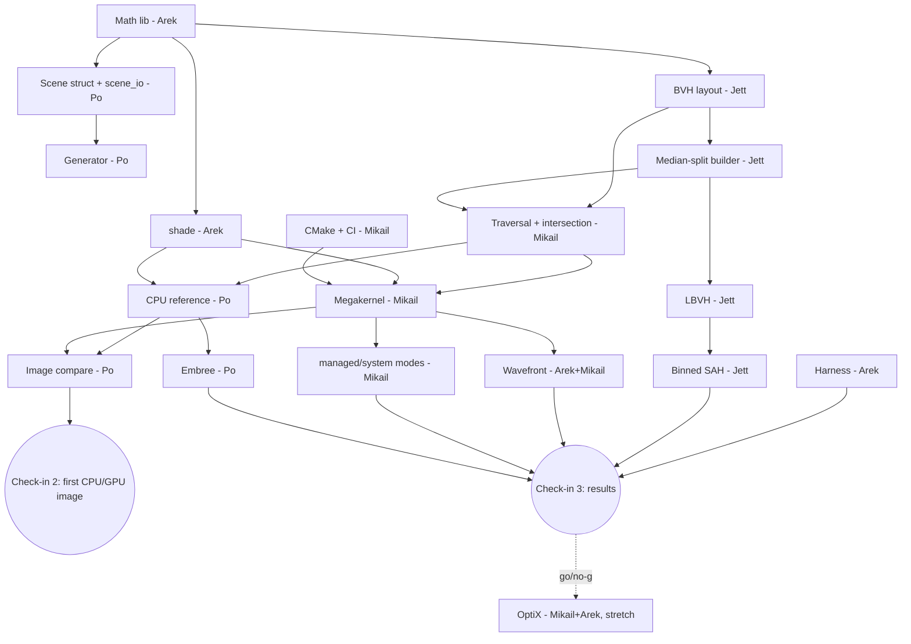

# Roadmap

Owners, tasks, dependencies, milestones, and risks. Per-person views are in [members/](members/). Jett tracks milestone status here.

Scope tags: **Core** = in the original proposal. **Extended** = added in planning. **Stretch** = go/no-go at check-in 3.

## Before check-in 1

- **Contract meeting, Sept 24–25.** All four sign off [INTERFACES.md](INTERFACES.md). Later changes follow the contract-change process.
- **Present extended goals at check-in 1.** Triangles, Embree, memory modes, wavefront, and OptiX go beyond the proposal. Present them to the instructor as extended goals layered on the original plan. The [reduced scope](#reduced-scope-fallback) stays the fallback, so missing an extension is not missing a commitment.

## Ownership

| Member | Original scope | Added in planning |
|---|---|---|
| Jett (M1) | Parallel BVH build, camera, prep scaling, milestones | `obj2bin` + Blender export; Embree backup |
| Mikail (M2) | GPU visibility, TACC builds, batch scripts | Top-level CMake/CUDA build, GitHub Actions CI, memory modes, OptiX (stretch) |
| Arek (M3) | GPU lighting/shadows, render timing | Math library, benchmark harness + timing schema, wavefront queues/shade/accumulate, OptiX pairing |
| Po (M4) | CPU reference, generator, image compare, CPU checks | `scene_io`, Embree baseline, CPU optimization pass |

Size key (part-time): **S** ≈ 1 day, **M** ≈ 2–4 days, **L** ≈ 1–2 weeks.

| Member | Load | Peak | Main risk |
|---|---|---|---|
| Jett | M–L | Oct–Nov | SAH scaling |
| Mikail | L | Sept–Oct (front-loaded) | Traversal on the critical path |
| Arek | M–L | Nov (wavefront) | Wavefront complexity |
| Po | Broadest (many M items) | All term | Breadth |

## Dependency graph

**Critical path to check-in 2:** math lib → BVH layout → traversal → (CPU reference + megakernel) → image compare.

### Stubs

Use these to keep working while a dependency isn't ready.

| Stub | Stands in for | Used by |
|---|---|---|
| Hand-written inline JSON scenes | Generator | All |
| Brute-force traversal (`brute_closest`, `brute_any`) | BVH traversal | Po's early reference |
| Hand-built tiny BVH (3 nodes) | Builders | Mikail |
| Synthetic `Hit` arrays | Traversal | Arek |
| Constant-color `shade()` | Real shading | Mikail's first megakernel |
| Synthetic AABB/centroid arrays | Scene + generator | Jett |

## Milestones

| Milestone | Date | Tasks done | Exit criteria |
|---|---|---|---|
| Contract meeting | Sept 24–25 | 2 (draft) | INTERFACES.md signed off |
| Check-in 1 | Sept 29 | 1, 2 | Repo builds on WSL2 + Vista, hello_cuda runs on GH200, CI green, contracts frozen |
| Check-in 2 | Oct 26–30 | 3–10, 11 started | CPU reference + first GPU image matching within tolerance; benchmark scenes fixed; initial timings |
| Check-in 3 | Nov 16–20 | 11–18 | Full renderer, multicore comparison, preliminary results, scope frozen, OptiX go/no-go |
| Ready | Nov 30 | 19, 20 (+21 if go) | Final runs, quality review, slides |
| Presentation | Dec 1/3 | | |
| Release | Dec 6 | | Report, tagged `final`, reproducibility instructions |

## Tasks

| # | Task | Owner(s) | Tag | Target |
|---|---|---|---|---|
| 1 | Repo skeleton, build, CI | Mikail | Core | Sept 29 |
| 2 | Contracts: math, Scene, scene_io | Arek, Po | Core | Sept 29 |
| 3 | First CPU image, brute force | Mikail, Jett, Po | Core | ~Oct 6 |
| 4 | Lighting + shadows on CPU | Arek | Core | ~Oct 10 |
| 5 | BVH layout, median builder, CPU traversal | Jett, Mikail, Po | Core | ~Oct 6 |
| 6 | Generator + binary format | Po | Core | ~Oct 10 |
| 7 | Image compare + regression tests | Po | Core | Oct 26 |
| 8 | Benchmark harness | Arek | Core | Oct 26 |
| 9 | Multicore CPU renderer + scaling | Po | Core | Oct 26 |
| 10 | CUDA megakernel, explicit memory | Mikail | Core | Oct 26 |
| 11 | LBVH builder | Jett | Core | Oct 26 |
| 12 | Blinn-Phong + directional lights | Arek | Core | Oct 26 |
| 13 | TACC sweep tooling | Mikail | Core | Nov 20 |
| 14 | Parallel binned SAH | Jett | Core | Nov 20 |
| 15 | Managed + system memory modes | Mikail | Extended | Nov 20 |
| 16 | Wavefront pipeline | Arek, Mikail | Extended | Nov 20 |
| 17 | Embree backend | Po (Jett backup) | Extended | Nov 20 |
| 18 | Optimization pass | Po, Mikail | Core | Nov 20 |
| 19 | `obj2bin` + Blender export | Jett | Extended | Late Nov |
| 20 | Final measurements, review, report | All | Core | Nov 30 / Dec 6 |
| 21 | OptiX backend | Mikail, Arek | Stretch | Late Nov if go |

LBVH (Task 11) and SAH (Task 14) are both Core, but the proposal only requires one parallel builder. If time runs short, keep whichever scales and report the other as partial.

### Task 1: Repo skeleton, build, CI
Owner: Mikail (all review). Due Sept 29. **Core.**
- **Objective:** a buildable empty project on WSL2 and Vista.
- **Guidance:**
  - CMake with options from [BUILD.md](BUILD.md#cmake-options); pinned FetchContent deps; `.clang-format`.
  - GitHub Actions CPU-only build + tests.
  - `hello_cuda` app; Vista module script + sbatch template.
  - Branch protection on `main` and `dev`; PR template. See [REPO_SKELETON.md](REPO_SKELETON.md).
- **Tests:** a placeholder test passes in CI.
- **Demo:** the same commit builds and runs `hello_cuda` on the laptop and a GH200 node. CI green.

### Task 2: Contracts: math lib, Scene struct, scene_io
Owners: Arek (math), Po (scene). Jett and Mikail sign off. Due Sept 29. **Core.**
- **Objective:** freeze shared types and the JSON format with inline geometry.
- **Guidance:**
  - vec3, Ray, AABB, `RT_HOSTDEV` macro.
  - Sphere, Triangle, Material, Light, Camera, Scene as flat arrays.
  - JSON read/write. Header-only types. No std containers in device code.
- **Tests:** math unit tests; JSON round-trip.
- **Demo:** `scene_dump scenes/two_spheres.json` prints the parsed scene.

### Task 3: First CPU image, brute force
Owners: Mikail (intersection), Jett (camera), Po (renderer). **Core.**
- **Objective:** an end-to-end image without a BVH.
- **Guidance:**
  - `RT_HOSTDEV` sphere + triangle intersection.
  - Camera ray generation.
  - Single-thread renderer over all primitives; normal-shading placeholder.
  - PNG + PFM writer; minimal `rt_render`.
- **Tests:** intersection (hit, miss, grazing, inside sphere, degenerate triangle); camera corner and center rays.
- **Demo:** PNG of a sphere on a triangle floor.

### Task 4: Lighting + shadows on CPU
Owner: Arek. **Core.**
- **Objective:** real shading through the brute-force path.
- **Guidance:**
  - `shade()` with Lambert + point lights.
  - Shadow rays with the robust offset (RT Gems Ch. 6); brute-force any-hit.
  - Develop on synthetic `Hit`s first.
- **Tests:** analytic cases (sphere-pole irradiance, inverse-square falloff, shadow boundary on the floor); no-acne test.
- **Demo:** shaded, shadowed image of the known-case scene.

### Task 5: BVH layout, median builder, CPU traversal
Owners: Jett (builder + validator), Mikail (traversal), Po (integration). **Core.**
- **Objective:** the CPU renderer uses a BVH.
- **Guidance:**
  - 32 B `BvhNode`; `PrimRef` type tag; `build_bvh(...)`.
  - Validator: containment, coverage, depth ≤ 64.
  - Stack-based `traverse_closest` / `traverse_any`; `--bvh median`.
- **Tests:** validator on random inputs; BVH vs brute-force give identical hits on random rays; images match.
- **Demo:** the Task 4 image, much faster on a 10K scene.

### Task 6: Generator + binary format
Owner: Po. **Core.**
- **Objective:** reproducible large scenes.
- **Guidance:**
  - PCG32 with own float conversion (no `std::` distributions).
  - Sphere fields, icospheres, triangle terrain, floor; size and seed params.
  - `.bin` with magic/version/counts/offsets; JSON references the `.bin`.
- **Tests:** same seed gives identical bytes on x86 and ARM (CI on x86, manual check on Vista); binary round-trip.
- **Demo:** `rt_gen --objects 1000000 --seed 1` output loads and renders on CPU.

### Task 7: Image compare + regression tests
Owner: Po. **Core.**
- **Objective:** automated quality gates.
- **Guidance:** `rt_compare` (max error, % pixels over threshold, diff heatmap PNG); small committed goldens; CI renders known-case scenes and compares.
- **Tests:** CI fails on a deliberately perturbed image.
- **Demo:** a PR that breaks shading is blocked.

### Task 8: Benchmark harness
Owner: Arek. **Core.**
- **Objective:** consistent timing everywhere.
- **Guidance:**
  - `steady_clock` + `cudaEvent` timer API.
  - Cold from process start; warm = 1 warm-up + median of 5.
  - Components; JSON/CSV with machine info + git commit; `rt_render --runs`.
- **Tests:** schema validation; components sum ≈ total.
- **Demo:** `results.json` from a CPU run with cold and warm breakdown.

### Task 9: Multicore CPU renderer + scaling script
Owner: Po. **Core.**
- **Objective:** the multicore baseline.
- **Guidance:** OpenMP over 16×16 tiles, `schedule(dynamic)`; `--threads N`; sweep script 1→max with a speedup plot.
- **Tests:** 1-thread vs N-thread images are bit-identical.
- **Demo:** scaling curves on the laptop and Vista.

### Task 10: CUDA megakernel, explicit memory → check-in 2
Owner: Mikail. **Core.**
- **Objective:** the first GPU image.
- **Guidance:** `DeviceMemory` explicit mode; upload scene + BVH; one thread per pixel calling shared traverse/shade; copy back; `--backend cuda --pipeline mega`.
- **Tests:** GPU vs CPU within tolerance on known-case and 100K scenes, on both machines.
- **Demo:** CPU/GPU side-by-side plus harness timings (upload vs render).

### Task 11: LBVH builder
Owner: Jett. **Core.**
- **Objective:** a scalable parallel build.
- **Guidance:** Morton codes; OpenMP radix sort; Karras 2012 hierarchy; bottom-up refit with atomics; depth cap; `--bvh lbvh`.
- **Tests:** validator; images match; deterministic builds.
- **Demo:** 1M-object build scaling, 1→72 threads.

### Task 12: Blinn-Phong + directional lights
Owner: Arek. **Core.**
- **Objective:** the final shading model.
- **Guidance:** specular behind `MAT_SPECULAR`; directional lights with unbounded shadow rays; multiple lights.
- **Tests:** analytic highlight position; directional shadow test.
- **Demo:** multi-light scene with highlights, CPU and GPU matching.

### Task 13: TACC sweep tooling
Owner: Mikail. **Core.**
- **Objective:** one-command benchmark runs on Vista.
- **Guidance:** parameterized sbatch (size, threads, backend, pipeline, mem, bvh); per-job results collection; node-hour log.
- **Tests:** dry run on `gh-dev`.
- **Demo:** a small sweep produces a merged CSV.

### Task 14: Parallel binned SAH
Owner: Jett. By Nov 20. **Core.**
- **Objective:** a best-quality BVH.
- **Guidance:** 16–32 bins; data-parallel binning at top levels, OpenMP tasks below a size threshold; leaf-size param; report SAH cost.
- **Tests:** validator; SAH cost < LBVH; images match.
- **Demo:** build vs render time table for median/LBVH/SAH at 3 sizes.

### Task 15: Managed + system memory modes
Owner: Mikail. GH200 only. **Extended.**
- **Objective:** the NVLink-C2C study.
- **Guidance:** `cudaMallocManaged` with and without prefetch; plain `malloc` pointers passed to kernels; runtime detection with graceful failure.
- **Tests:** images match across modes.
- **Demo:** per-mode upload/render times on GH200 next to laptop explicit numbers.

### Task 16: Wavefront pipeline
Owners: Arek (queues, shade, accumulate), Mikail (trace kernels). **Extended.** First cut candidate.
- **Objective:** a second GPU pipeline with per-stage timing.
- **Guidance:** HitBuffer, ShadowRayQueue, contribution buffer; atomic counters; compaction; per-stage `cudaEvent`s; `--pipeline wavefront`.
- **Tests:** matches megakernel within tolerance.
- **Demo:** mega vs wavefront timings with stage breakdown.

### Task 17: Embree backend
Owner: Po (Jett backup). **Extended.**
- **Objective:** the "best possible CPU" baseline.
- **Guidance:** optional CMake target; triangles + native spheres; shading through the same `shade()`; verify ARM64 build on Vista.
- **Tests:** matches CPU reference within tolerance.
- **Demo:** our CPU vs Embree at 72 threads.

### Task 18: Optimization pass
Owners: Po (CPU), Mikail (GPU traversal). **Core.**
- **Objective:** strong, fair baselines on both sides.
- **Guidance:** CPU data layout + `-fopt-info-vec` reports; GPU nearer-child-first traversal, node layout, occupancy via Nsight Compute.
- **Tests:** regression suite passes.
- **Demo:** before/after timings.

### Task 19: `obj2bin` + Blender export
Owner: Jett. **Extended.**
- **Objective:** demo scenes.
- **Guidance:** tinyobjloader with triangulation; MTL `Kd`/`Ks`/`Ns` → Blinn-Phong; Z-up → Y-up; Blender Python script exports camera and lights to JSON.
- **Tests:** a cube OBJ converts to the expected 12 triangles.
- **Demo:** a Blender-made scene rendered on GPU.

### Task 20: Final measurements, quality review, report → check-in 3, Nov 30, Dec 6
Owners: all (Jett and Arek measure; Mikail and Po validate; all prepare slides). **Core.**
- **Objective:** the study results.
- **Guidance:** full Vista sweeps; plots from [BENCHMARKING.md](BENCHMARKING.md#planned-plots); two-person side-by-side review; reproducibility instructions; tagged release.
- **Demo:** report figures + presentation.

### Task 21: OptiX backend (go/no-go at check-in 3)
Owners: Mikail, Arek pairing. **Stretch.**
- **Objective:** the RT-core comparison.
- **Guidance:** hardware triangles + built-in spheres; raygen reuses `shade()`; verify OptiX on WSL2 early, else build this backend natively on Windows. Details in [STRETCH.md](STRETCH.md#optix-backend).
- **Demo:** 2×2 table {H100, 4070} × {CUDA mega, OptiX}.

Go criteria at check-in 3: Tasks 1–14 done, OptiX verified working on the 4070, and at least 1.5 weeks left for Mikail and Arek.

## Risks

| Risk | Early signal | Response |
|---|---|---|
| Vista access or build blocks testing (proposal) | Test by Sept 29 | Lonestar6 A100; continue CPU work |
| Prep, transfers, or GPU execution limit speedup (proposal) | October timings; component data by Nov 20 | Tune the largest cost; report achieved numbers honestly |
| Rendering errors pass casual inspection (proposal) | Known-case tests + `rt_compare` from October | Fix or disable approximations; keep the verified mode |
| Coursework, absences, queue waits (proposal) | Weekly review | Reduced scope by Nov 20; keep preliminary results |
| SAH build doesn't scale | Jett's scaling curve flat past ~16 threads | Ship LBVH as the parallel builder; report SAH as quality reference |
| OptiX doesn't run in WSL2 | `optixSphere` sample fails | Native Windows build for that backend only, or drop Stretch |
| CUDA/GCC version mismatch on Vista | Task 1 build fails | Pick a matching `cuda` + `gcc` module pair; document in BUILD.md |
| Po's breadth of tasks | Missed Oct 26 items | Move Embree to Jett; Jett and Arek help validate the reference |
| Queue waits / node-hour overrun | Node-hour log > 50% before Nov | Develop on laptop; batch sweeps; fewer sweep points |
| Contract churn after Sept 29 | Repeated `contract` PRs | Freeze; batch changes at check-ins |

## Reduced-scope fallback

Adopted by Nov 20 if needed (from proposal):

- One fixed scene of spheres + floor, one light, shadows, 640×480.
- Keep: parallel CPU preparation, GPU rendering, quality checks, single- and multicore CPU comparisons.
- Drop: camera controls, larger scenes, and all Extended and Stretch items.
- Report measured performance even if targets are missed.

## Milestone status

Updated by Jett weekly.

| Task | Status | Notes |
|---|---|---|
| 1 | Not started | |
| 2 | Not started | |
