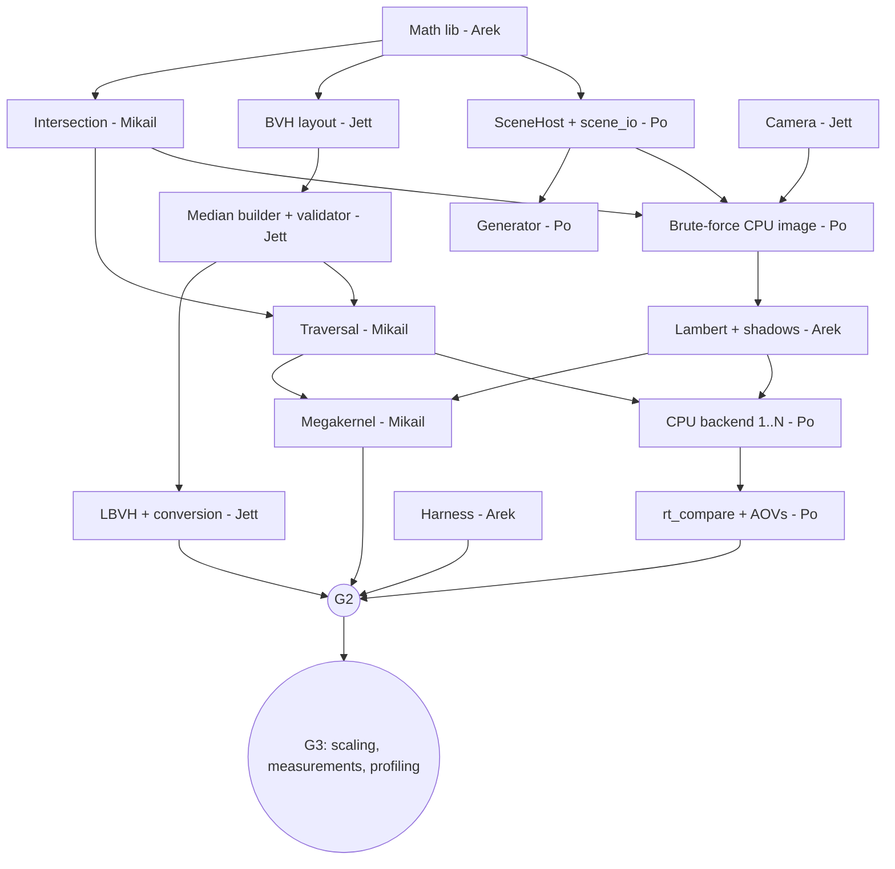

# Roadmap

**Re-baselined Oct 24.** As of this date the repository contains planning docs only, with no code merged. The original September dates no longer describe an executable plan. If work exists outside this repo, merge it and update [Status](#status) before using these dates.

Owners, gates, tasks, and risks are below. Per-person views are in [members/](members/). Jett updates the status table weekly.

## Scope

Tags: **Core** = required deliverable. **Extension** = earns its place only after the Core gates pass, in priority order. **Stretch** = future work, unlikely this term.

### Required deliverable (Core)

1. Spheres and triangles, one Lambert point-light model, hard shadows (multiple point lights allowed).
2. Serial median BVH (correctness baseline) and **one** scalable parallel builder: **LBVH**.
3. CPU renderer, single-core and multicore.
4. CUDA megakernel with explicit memory, matching the CPU per the [quality protocol](BENCHMARKING.md#quality-protocol).
5. Validation: analytic tests, double-precision oracle, BVH vs brute force, `rt_compare`, determinism.
6. Measurements: T_app, T_br, T_frame; CPU and preparation scaling; GPU breakdown; profiling.

Triangles are Core: the floor in every known-case scene is two triangles, and triangle support is a single intersection function plus a type tag.

### Extensions (in priority order, each timeboxed)

| # | Extension | Owner | Earliest start | Timebox | Why this order |
|---|---|---|---|---|---|
| E1 | `managed` + `system` memory modes on the GH node | Mikail | After G2 | 4 days | Directly answers the proposal's "when does data movement limit the gain" |
| E2 | Blinn-Phong + directional lights | Arek | After G1 | 2 days | Small; better images |
| E3 | Parallel binned SAH | Jett | After G2 | 1 week | Build cost vs tree quality, the preparation tradeoff |
| E4 | Embree baseline | Po (Jett backup) | After G2 | 4 days | "Best possible CPU" tier |
| E5 | Wavefront pipeline | Arek, Mikail | After G3 | 1 week | Per-stage GPU timing; first to cut |
| E6 | `obj2bin` + Blender export | Jett | After G3 | 3 days | Demo images only |

At check-in 3 the team picks which extensions to run, based on remaining time and on what the preliminary results raise. Realistically E1–E3 fit; the rest are likely cut. Extensions never block a Core gate.

### Stretch (not planned)

OptiX backend, mirror reflections, GPU-side LBVH build, SIMD packet tracing. See [STRETCH.md](STRETCH.md).

## Gates and schedule

| Gate | Date | Exit criteria | Event |
|---|---|---|---|
| **G0** | Oct 30 | INTERFACES v0.3 signed off (Oct 27). Repo builds CPU-only in CI and with CUDA on the laptop and Vista. `hello_cuda` prints the recorded GPU name on a GH node. Brute-force CPU image of `known_two_spheres` (normal shading). | |
| **G1** | Nov 6 | Lambert + point-light shadows on CPU passing analytic tests. Median BVH + validator; BVH = brute force exactly. Multicore CPU bit-identical to 1 thread. `rt_gen` + `.bin` + hash. `rt_compare` with AOV checks. Harness reports T_br and T_frame on CPU. Benchmark scene sizes fixed. | Check-in 2 (postponed to ~Oct 31–Nov 7, date TBD) |
| **G2** | Nov 13 | CUDA megakernel passes `rt_compare` against CPU on known scenes and `bench_100k`, on laptop and Vista. LBVH + layout conversion: validator passes, deterministic for any thread count. First Vista T_app / T_br / T_frame at 3 sizes. Tolerances fixed with evidence. | |
| **G3** | Nov 18 | Preparation scaling (B = 1→72) and CPU render scaling. GPU breakdown. Profiling done (`-Xptxas -v`, Nsight). Preliminary 10× / 2× / 20× ratios. Scope frozen; extensions chosen. | Check-in 3 (Nov 16–20) |
| Final | Nov 30 | Final sweeps, quality review (2 reviewers), slides. Thanksgiving is Nov 26; plan around it. | |
| | Dec 1/3 | | Presentation |
| | Dec 6 | Report, reproducibility instructions, `final` tag | Release |

**Check-in 2 (postponed).** It moved from Oct 26–30 to roughly 1–2 weeks after Oct 24. Record the exact date in [Status](#status) once it's announced. The gate dates don't move: the postponement buys no extra time before check-in 3 and the final deadline, so the team keeps working to G0 (Oct 30) and G1 (Nov 6). Present the latest gate that has passed:

| If check-in 2 falls on | Present |
|---|---|
| Oct 31–Nov 5 | G0 complete, the re-baselined plan, G1 progress (shaded CPU image, median BVH if merged) |
| Nov 6–7 | G1 complete: correct CPU renderer with shadows, BVH, multicore, `rt_compare`, first CPU timings, fixed benchmark scenes |

The first GPU image remains a G2 item (Nov 13). Don't pull it forward at the cost of G1's correctness checks. Check-in 3 (Nov 16–20) is assumed unchanged; update this table if it moves too.

**Reduced-scope trigger:** if G2 is not met by **Nov 13**, adopt the [reduced scope](#reduced-scope-fallback) immediately (earlier than the proposal's Nov 20) and spend the remaining time on measurement.

## Ownership

| Member | Core | Extensions |
|---|---|---|
| Jett (M1) | Camera; median builder + validator; LBVH + layout conversion + depth fallback; preparation scaling; shading expected values (independent check); milestones | E3 SAH, E6 `obj2bin`, E4 backup |
| Mikail (M2) | Skeleton, CMake, CI, Vista; intersection + traversal; `DeviceScene` + megakernel; sweep scripts; GPU profiling; node-hour log | E1 memory modes, E5 trace kernels |
| Arek (M3) | Math library; Lambert shading + shadow rays; harness (T_app / T_br / T_frame); double-precision intersection oracle; plots | E2 Blinn-Phong, E5 queues/shade/accumulate |
| Po (M4) | `SceneHost` + `scene_io` + hash; generator; CPU backend (1 and N threads); `rt_compare` + AOV checks; CPU render scaling; final reproducibility | E4 Embree |

Cross-checks: each shared function's independent check is written by someone other than its author. Arek checks Mikail's intersection; Jett checks Arek's shading values; Mikail and Po check Jett's builders through BVH-vs-brute-force tests.

## Dependency graph (Core only)

**Critical path:** math lib → intersection → brute-force image → traversal → megakernel → `rt_compare` pass at G2.

### Stubs

| Stub | Stands in for | Used by |
|---|---|---|
| Inline JSON known-case scenes | Generator | All |
| `brute_closest` / `brute_any` | BVH traversal | Po, Arek, Mikail's first kernel |
| Hand-built 3-node BVH | Builders | Mikail |
| Synthetic `Hit` / `SurfacePoint` arrays | Traversal | Arek |
| Normal-as-color shading | Real shading | First CPU and GPU images |
| Synthetic AABB/centroid arrays | Scene + generator | Jett |

## Core tasks

| # | Task | Owner(s) | Gate |
|---|---|---|---|
| C1 | Skeleton, build, CI, Vista verification | Mikail | G0 |
| C2 | Contracts v0.3 sign-off; math lib; `SceneHost`, `scene_io`, hash | Arek, Po (all sign) | G0 |
| C3 | Intersection (watertight triangle, stable sphere, NaN-safe slab) + camera + brute-force CPU image | Mikail, Jett, Po | G0 |
| C4 | Lambert + point-light shadows, frozen shadow-ray rules | Arek | G1 |
| C5 | Median builder, validator, traversal; BVH = brute force | Jett, Mikail | G1 |
| C6 | Generator, `.bin`, hash, cross-machine determinism | Po | G1 |
| C7 | CPU backend 1..N threads (16×16 tiles, dynamic) | Po | G1 |
| C8 | `rt_compare` with AOVs; analytic tests; double oracle; CI goldens | Po, Arek, Jett | G1 |
| C9 | Harness: T_app, T_br, T_frame, components, results schema v2 | Arek | G1 (CPU), G2 (GPU) |
| C10 | `DeviceScene` (explicit) + megakernel | Mikail | G2 |
| C11 | LBVH + layout conversion + depth fallback | Jett | G2 |
| C12 | Sweep scripts, node-hour log | Mikail | G2 |
| C13 | Scaling studies, GPU breakdown, profiling, preliminary ratios | All (Jett, Po CPU; Mikail, Arek GPU) | G3 |
| C14 | Final runs, quality review, report, release | All | Final |

### C1: Skeleton, build, CI, Vista verification
Owner: Mikail.
- **Objective:** a buildable project on WSL2 and Vista.
- **Guidance:**
  - CMake options from [BUILD.md](BUILD.md#cmake-options); pinned FetchContent; `.clang-format`.
  - CI per [REPO_SKELETON.md](REPO_SKELETON.md#ci-workflow-outline).
  - `hello_cuda` prints `cudaGetDeviceProperties` name and SM count.
  - Record the tested GCC + CUDA pair on each machine in BUILD.md.
  - Branch protection; PR template.
- **Tests:** placeholder test in CI.
- **Demo:** the same commit builds on the laptop and a GH node; CI green.

### C2: Contracts and core types
Owners: Arek (math), Po (scene). All four sign off by Oct 27.
- **Objective:** INTERFACES v0.3 accepted; shared headers merged.
- **Guidance:** `vec3`, `Ray`, `AABB`, `intersect_aabb`; `SceneHost`, `Scene`, `Image`; JSON v2 read/write; scene hash.
- **Tests:** slab-test cases listed in INTERFACES; JSON round trip; hash stable across runs.
- **Demo:** `scene_dump scenes/known/two_spheres.json` prints the scene and its hash.

### C3: Intersection, camera, brute-force CPU image
Owners: Mikail (intersection), Jett (camera), Po (renderer loop, PNG/PFM).
- **Objective:** first end-to-end image, no BVH.
- **Guidance:** frozen rules from [INTERFACES.md](INTERFACES.md#5-intersection-and-traversal); `camera_ray` per section 4; normal-as-color; CPU pixel loop over `render_pixel<BruteQuery>`; `rt_render --backend cpu --bvh none`.
- **Tests:** hit, miss, grazing, inside sphere, degenerate triangle, shared edge (exactly one triangle wins the tie), camera center and corner rays.
- **Demo:** PNG of a sphere on a two-triangle floor.

### C4: Lambert + point-light shadows
Owner: Arek. Expected values: Jett.
- **Objective:** Core shading.
- **Guidance:** shadow-ray rules and accumulation order from [INTERFACES.md](INTERFACES.md#6-shading); `light_mask` AOV.
- **Tests:** analytic cases from the [quality protocol](BENCHMARKING.md#1-independent-correctness-checks-ci); a light behind the surface emits no shadow ray.
- **Demo:** shaded, shadowed known-case image.

### C5: Median builder, validator, traversal
Owners: Jett (builder, validator), Mikail (traversal).
- **Objective:** CPU rendering through the BVH.
- **Guidance:** canonical order, median rules, edge cases, and node culling rule from INTERFACES sections 3 and 5.
- **Tests:** validator on random, clustered, all-equal, 0, 1, and 2 primitives; BVH vs brute force bit-identical hits on random rays.
- **Demo:** same image as C4, much faster on `bench_10k`.

### C6: Generator, `.bin`, hash
Owner: Po.
- **Objective:** reproducible large scenes, sized in primitives.
- **Guidance:** PCG32; generator compiled with `-ffp-contract=off`; `--spheres`, `--terrain-tris`, `--seed`; `generator.command` recorded in JSON.
- **Tests:** same `content_hash` on laptop and Vista; `.bin` round trip; reader rejects bad headers.
- **Demo:** `bench_1m` loads and renders on CPU.

### C7: CPU backend, 1..N threads
Owner: Po.
- **Objective:** single-core and multicore baselines.
- **Guidance:** OpenMP over 16×16 tiles, `schedule(dynamic)`, `num_threads(R)`; preparation uses B.
- **Tests:** 1 vs N threads bit-identical (PFM and AOVs).
- **Demo:** scaling curve on the laptop.

### C8: Validation tooling
Owners: Po (`rt_compare`, goldens), Arek (double oracle), Jett (shading expected values).
- **Objective:** automated correctness and comparison gates.
- **Guidance:** all checks in the [quality protocol](BENCHMARKING.md#quality-protocol).
- **Tests:** `rt_compare` fails on an injected NaN, a shifted single object, a 10×10 block of wrong pixels, and a flipped shadow region.
- **Demo:** a PR that breaks shading is blocked by CI.

### C9: Harness
Owner: Arek.
- **Objective:** trustworthy timing.
- **Guidance:** quantities and rules in [BENCHMARKING.md](BENCHMARKING.md#timing-quantities); results schema v2; `--mode app|prepared` (app = one T_app measurement, then exit; prepared = T_br ×5 + T_frame ×5); a script that runs 5 fresh processes for T_app.
- **Tests:** schema validation; median and spread computed correctly; `unattributed` reported.
- **Demo:** results JSON for CPU (G1), then CUDA (G2).

### C10: DeviceScene + megakernel
Owner: Mikail.
- **Objective:** GPU image matching CPU.
- **Guidance:** per-array uploads; `Scene` view by value as a kernel argument; `DeviceScene` uploads scene and BVH; one thread per pixel calling `render_pixel` and writing its `PixelResult`; framebuffer and AOV buffers allocated in `prepare` from `RenderSettings` and reused.
- **Tests:** `rt_compare` passes vs CPU on known scenes and `bench_100k`, on laptop and Vista; repeated GPU runs bit-identical.
- **Demo:** CPU/GPU side by side with T_br and T_frame.

### C11: LBVH
Owner: Jett.
- **Objective:** the required parallel builder.
- **Guidance:** Morton quantization, stable radix sort, Karras, refit, layout conversion, and depth fallback, all per [INTERFACES.md](INTERFACES.md#3-bvh-layout-and-build-pipeline). Report `bounds`, `build`, and `layout` separately.
- **Tests:** validator; output bytes identical for B = 1, 8, 72; images pass `rt_compare` vs median; `fallbacks` reported (expected 0).
- **Demo:** `bench_1m` preparation scaling on Vista.

### C12: Sweep scripts
Owner: Mikail.
- **Objective:** one-command Vista runs.
- **Guidance:** parameterized sbatch; records `nvidia-smi`, `lscpu`, `module list`; collects results JSON; logs node-hours.
- **Tests:** dry run on `gh-dev`.
- **Demo:** a small sweep produces a merged CSV.

### C13: Measurements and profiling
Owners: all.
- **Objective:** preliminary results for check-in 3.
- **Guidance:** Core sweeps and plots from [BENCHMARKING.md](BENCHMARKING.md#sweeps); profiling requirements; preliminary ratios with spread.
- **Demo:** check-in 3 slides with T_br / T_frame / T_app ratios and breakdowns.

### C14: Final
Owners: all (Jett and Arek measure; Mikail and Po validate; all write).
- **Objective:** report and release.
- **Guidance:** final sweeps; 2-reviewer side-by-side review; reproducibility instructions (exact commands, hashes, modules); `final` tag.

## Risks

| Risk | Early signal | Response |
|---|---|---|
| Schedule: 5 weeks for the whole Core | G0 or G1 slips | Reduced scope at Nov 13; no extensions before G2 |
| Vista GPU access or build fails | C1 by Oct 30 | Lonestar6 A100; laptop measurements continue |
| CUDA/GCC pair unsupported | C1 build fails | Try module pairs; check NVIDIA's versioned install guide for that CUDA minor; record the working pair |
| Shared bug makes CPU and GPU agree | Analytic or oracle test fails | Independent checks by a different author (see Ownership) |
| LBVH doesn't scale (sort or refit bound) | Flat scaling past ~16 threads | Profile per stage (`bounds`, `build`, `layout`); report honestly; SAH not a rescue |
| LBVH not correct by G2 | Validator or determinism failures on **Nov 10** | Jett switches to the task-parallel median builder (2-day job, same output as serial median). LBVH continues only if time remains after G2 |
| Prep or transfers limit speedup | G2 timings | That's a study result: report it with breakdowns |
| Po's breadth | C6–C8 slip | Arek takes the goldens/CI wiring; Jett takes the generator terrain |
| Node-hour overrun | Log > 50% before Nov 13 | Develop on the laptop; fewer sweep points |

## Reduced-scope fallback

From the proposal; adopted at Nov 13 if G2 fails:

- One fixed scene of spheres + a two-triangle floor, one point light, shadows, 640×480.
- Keep: parallel CPU preparation, GPU rendering, quality checks, single- and multicore comparisons, T_br and T_frame.
- Parallel builder: LBVH if it already passes the validator and determinism tests; otherwise the **task-parallel median builder** (see below). Shrinking the scene doesn't help if LBVH itself is what blocks G2, so the fallback can't depend on it.
- Drop: camera controls, large scenes, all extensions.
- Report measured performance even if targets are missed.

## Status

Updated by Jett weekly.

| Item | Status (Oct 24) | Notes |
|---|---|---|
| Check-in 2 date | Postponed, TBD (~Oct 31–Nov 7) | Fill in when announced |
| INTERFACES v0.3 | Proposed | Sign-off Oct 27 |
| C1 | Not started | Vista GPU access not yet verified in repo |
| C2–C14 | Not started | |
