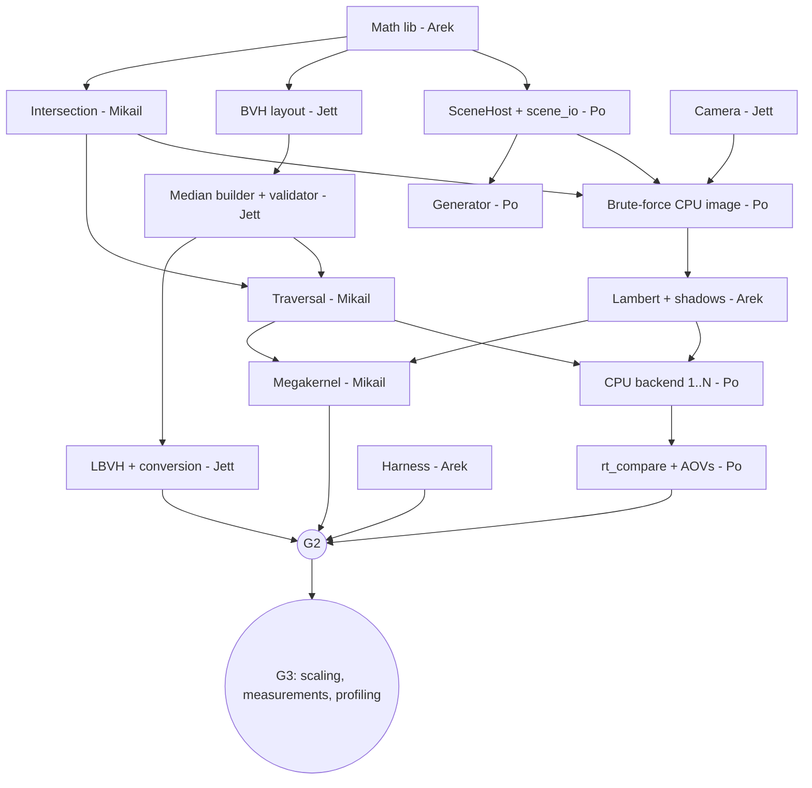

# Roadmap

**Re-baselined Oct 24.** As of this date the repository contains planning docs only, with no code merged. The original September dates no longer describe an executable plan. If work exists outside this repo, merge it and update [Status](#status) before using these dates.

Owners, gates, tasks, and risks are below. Per-person views are in [members/](members/). Jett updates the status table weekly.

## Scope

Tags: **Core** = required deliverable. **Extension** = earns its place only after the Core gates pass, in priority order. **Stretch** = future work, unlikely this term.

### Required deliverable (Core)

1. Spheres and triangles, one Lambert point-light model, hard shadows (multiple point lights allowed).
2. Serial median BVH (correctness baseline) and **one correct parallel builder**. **LBVH is the preferred implementation.** The task-parallel median builder is an accepted alternative that satisfies the same requirement if LBVH isn't correct at the Nov 10 decision point (see [C11](#c11-parallel-builder-lbvh-preferred)).
3. CPU renderer, single-core and multicore.
4. CUDA megakernel with explicit memory, matching the CPU per the [quality protocol](BENCHMARKING.md#quality-protocol).
5. Validation: analytic tests, double-precision oracle, BVH vs brute force, `rt_compare`, determinism.
6. Measurements: T_app, T_br, T_frame; CPU and preparation scaling; GPU breakdown; profiling.

Triangles are Core: the floor in every known-case scene is two triangles, and triangle support is a single intersection function plus a type tag.

### Extensions (in priority order, each timeboxed)

| # | Extension | Owner | Earliest start | Timebox | Why this order |
|---|---|---|---|---|---|
| E1 | `managed` + `system` memory modes on the GH node | Mikail | After G2 | 4 days | Directly answers the proposal's "when does data movement limit the gain" |
| E2 | Blinn-Phong + directional lights | Arek | After G2 | 2 days | Small; better images. Waits for G2 like every extension, so shading is frozen while CPU/GPU tolerances are calibrated |
| E3 | Parallel binned SAH | Jett | After G2 | 1 week | Build cost vs tree quality, the preparation tradeoff |
| E4 | Embree baseline | Po (Jett backup) | After G2 | 4 days | "Best possible CPU" tier |
| E5 | Wavefront pipeline | Arek, Mikail | After G3 | 1 week | Per-stage GPU timing; first to cut |
| E6 | `obj2bin` + Blender export | Jett | After G3 | 3 days | Demo images only |

**No extension starts before G2.** At check-in 3 the team picks which extensions to run, based on remaining time and on what the preliminary results raise. Realistically E1–E3 fit; the rest are likely cut. Extensions never block a Core gate.

### Stretch (not planned)

OptiX backend, mirror reflections, GPU-side LBVH build, SIMD packet tracing. See [STRETCH.md](STRETCH.md).

### Deferred (designed, not required)

Worked out during review, but not needed for the parts to fit together. Pick one up only if its trigger happens.

| Item | Where | Pick up if |
|---|---|---|
| Extra `rt_compare` checks, `known_dense_mesh`, dense-mesh corruption tests | [BENCHMARKING.md](BENCHMARKING.md#deferred-comparison-hardening) | A visibly wrong image passes `rt_compare` |
| Exact goldens in a pinned CI container | [BUILD.md](BUILD.md#golden-image-environment-deferred) | Tolerance goldens miss a regression |
| `RT_COUNTERS` traversal counters | [BUILD.md](BUILD.md#cmake-options) | Traversal cost needs explaining in the report |
| `--no-components` overhead check | [BENCHMARKING.md](BENCHMARKING.md#timing-quantities) | Instrumentation seems to distort small scenes |
| `field_clustered` and seed-2 scenes | [BENCHMARKING.md](BENCHMARKING.md#scene-families) | Time remains after G2 |
| Heavier review and CI process | [WORKFLOW.md](WORKFLOW.md#deferred-process) | The listed problem actually occurs |

## Gates and schedule

| Gate | Date | Exit criteria | Event |
|---|---|---|---|
| **G0** | Oct 30 | INTERFACES v1.0 signed off (Oct 27). Repo builds CPU-only in CI and with CUDA on the laptop and Vista. `hello_cuda` prints the recorded GPU name on a GH node. Brute-force CPU image of `known_two_spheres` (normal shading). | |
| GPU smoke | **~Nov 3** | Normal-colored image of `known_two_spheres` from a CUDA kernel running `render_pixel<BruteQuery, NormalShading>`, on the laptop and a GH node. Finite pixels; `prim_id` matches the CPU brute-force image except explained mismatches. No BVH, no lighting, no performance claims. | |
| **G1** | Nov 6 | Lambert + point-light shadows on CPU passing analytic tests. Median BVH + validator; BVH = brute force exactly. Multicore CPU bit-identical to 1 thread. `rt_gen` `field_uniform` + `.bin` + hash. `rt_compare` core checks (nonfinite, explained mismatches, shading tolerance). Harness reports T_br and T_frame on CPU. Benchmark scene definitions fixed. | Check-in 2 (postponed to ~Oct 31–Nov 7, date TBD) |
| **G2** | Nov 13 | CUDA megakernel passes `rt_compare` against CPU on the known scenes and `bench_100k`, on laptop and Vista. A correct parallel builder (LBVH, or the task-parallel median per the Nov 10 decision): validator passes, deterministic for any thread count. First Vista T_app / T_br / T_frame at 3 sizes. Comparison tolerances set from real CPU/GPU data. | |
| **G3** | Nov 18 | Preparation scaling (B = 1→72) and CPU render scaling. GPU breakdown. Profiling done (`-Xptxas -v`, Nsight). Preliminary 10× / 2× / 20× ratios. Scope frozen; extensions chosen. | Check-in 3 (Nov 16–20) |
| Final | Nov 30 | Final sweeps, quality review (2 reviewers), slides. Thanksgiving is Nov 26; plan around it. | |
| | Dec 1/3 | | Presentation |
| | Dec 6 | Report, reproducibility instructions, `final` tag | Release |

**Check-in 2 (postponed).** It moved from Oct 26–30 to roughly 1–2 weeks after Oct 24. Record the exact date in [Status](#status) once it's announced. The gate dates don't move: the postponement buys no extra time before check-in 3 and the final deadline, so the team keeps working to G0 (Oct 30) and G1 (Nov 6). Present the latest gate that has passed:

| If check-in 2 falls on | Present |
|---|---|
| Oct 31–Nov 5 | G0 complete, the re-baselined plan, G1 progress (shaded CPU image, median BVH if merged) |
| Nov 6–7 | G1 complete: correct CPU renderer with shadows, BVH, multicore, `rt_compare`, first CPU timings, fixed benchmark scenes |

The **GPU smoke image** (~Nov 3) can be shown at check-in 2 as evidence that the device path works: device compilation of shared code, scene pointers, kernel launch, download. Full GPU correctness and performance acceptance stay at G2 (Nov 13). Check-in 3 (Nov 16–20) is assumed unchanged; update this table if it moves too.

**Reduced-scope trigger:** if G2 is not met by **Nov 13**, adopt the [reduced scope](#reduced-scope-fallback) immediately (earlier than the proposal's Nov 20) and spend the remaining time on measurement.

## Ownership

| Member | Core | Extensions |
|---|---|---|
| Jett (M1) | Camera; median builder + validator; parallel builder (LBVH preferred, task-parallel median fallback) + layout conversion + depth fallback; **terrain generation** (height field); preparation scaling; shading expected values (independent check); milestones | E3 SAH, E6 `obj2bin`, E4 backup |
| Mikail (M2) | Skeleton, CMake, CI, Vista; intersection + traversal; **GPU smoke image**; `DeviceScene` + megakernel; sweep scripts; GPU profiling; node-hour log | E1 memory modes, E5 trace kernels |
| Arek (M3) | Math library; Lambert shading + shadow rays; harness (T_app / T_br / T_frame); double-precision intersection oracle; **golden-image CI integration** (render known scenes, compare, commit goldens); plots | E2 Blinn-Phong, E5 queues/shade/accumulate |
| Po (M4) | `SceneHost` + `scene_io` + validation + hash; sphere placement + `.bin` for `rt_gen`; image IO; CPU backend (1 and N threads); `rt_compare` + core corruption tests; CPU render scaling; final reproducibility | E4 Embree |

**Load balancing, assigned up front** (not only if Po slips): terrain generation moves to Jett, and golden-image CI integration moves to Arek. Both are S-sized and fit beside their Core work: Jett's median builder doesn't depend on terrain, and Arek's shading work is lighter than the others' through G1. Po keeps the scene contract, sphere layouts, CPU backend, and `rt_compare`. Extra `rt_compare` hardening is [deferred](BENCHMARKING.md#deferred-comparison-hardening).

Cross-checks: each shared function's independent check is written by someone other than its author. Arek checks Mikail's intersection; Jett checks Arek's shading values; Mikail and Po check Jett's builders through BVH-vs-brute-force tests.

## Dependency graph (Core only)

**Critical path:** math lib → intersection → brute-force image → traversal → megakernel → `rt_compare` pass at G2.

### Stubs

| Stub | Stands in for | Used by |
|---|---|---|
| Inline JSON known-case scenes | Generator | All |
| `brute_closest` / `brute_any` | BVH traversal | Po, Arek, Mikail's first kernel |
| Hand-built 3-node BVH | Builders | Mikail |
| Synthetic `Hit` / `SurfacePoint` arrays | Traversal | Arek |
| `NormalShading` policy (`--shade normal`) | Real shading | First CPU and GPU images |
| Synthetic AABB/centroid arrays | Scene + generator | Jett |

### Stub register

The table above lists the stand-ins the plan expects. This register lists the ones **actually in the code**, so none gets forgotten. It covers stubs (a stand-in for a dependency that hasn't landed) and local workarounds (a local fix for a gap or bug in someone else's code). The rules, the code marker format, and the CI check are in [WORKFLOW.md](WORKFLOW.md#stubs-and-local-workarounds).

| ID | Used by | Where | Stands in for | Remove when | Status |
|---|---|---|---|---|---|
| none yet | | | | | |

`Status` is `open` while the real thing hasn't landed, and `ready to remove` once it has but the stub is still in the code. Add a row in the PR that adds the stub (next free ID, `S1`, `S2`, ...), and delete the row in the PR that removes it. The weekly meeting reads this table.

### Start-now check and cross-owner blockers (Oct 28)

**Can everyone start their first task today?** Yes. `core` (Arek) and the CMake skeleton (Mikail) are on `dev`, and every first task is either independent or has a stub above. What remains is a handful of small shared headers that two owners would otherwise define separately, and some symbols nobody's deliverable list covers. Both are cheap to fix now and expensive to find at G0 (Oct 30).

| Owner | First task | Start today? | Use until the dependency lands |
|---|---|---|---|
| Po | `Scene` types, JSON IO, hash, validation, `scene_dump` | Yes. Needs only `vec3` (merged) | A local `Camera` matching INTERFACES §4 exactly. `SceneHost` holds a `Camera`, but Po's member file doesn't list it as a dependency |
| Jett | `camera_ray` and tests | Yes. Needs only `Ray` and `vec3` (merged) | Nothing. For the bounds stage and median builder, use synthetic AABB and centroid arrays |
| Mikail | `intersect_sphere`/`intersect_triangle`, `brute_*`, `Hit` | Yes. The signatures take only `Sphere`, `Triangle`, `Ray` | `Sphere`, `Triangle` and `PrimRef` as written in INTERFACES §2–§3. Don't redefine them in a second place (see fix 1) |
| Arek | `NormalShading`, then `shade_hit` | Partly. `Hit`, `Scene` and `PixelResult` don't exist yet | Hand-made `Hit` and `Scene` in tests. Unblocked work: `Timings` and timers, `offset_ray_origin`, the double-precision oracle (it needs only the frozen signatures), issues #2–#5 |

Once someone's header lands on `dev`, the others delete their stand-ins. A stand-in lives in a test file or a clearly named `*_stub.hpp`, never under a contract type's real name, so two definitions can't collide at merge.

**Cross-owner blockers and proposed fixes.** These are proposals. The ones that assign ownership need each affected owner's agreement; none changes a type or signature in INTERFACES.md.

| # | Blocker | Who waits on whom | Proposed fix |
|---|---|---|---|
| 1 | The scene types are the hub. `Sphere`, `Triangle`, `Material`, `Light` and the `Scene` view all come from `scene/scene.hpp`, which Mikail, Arek, Jett and Po's own backend all include | Everyone waits on Po | Po commits `scene/scene.hpp` first, as plain structs copied from INTERFACES §2 with the `static_assert`s. No logic, about an hour. Do it on Oct 28–29 |
| 2 | Contract types that live in different owners' headers: `Camera` (Jett, §4), `PrimRef` and `BvhView` (Jett, §3), `Hit` (Mikail, §5), `PixelResult` (Arek, §6), `Backend`, `PrepareInput`, `RenderSettings` (Mikail, §7) | Arek needs `Hit`, Mikail needs `PixelResult`, Po needs `Camera` and `Backend` | Each owner lands a **declarations-only** header for their types by Oct 29, ahead of any logic: `camera/camera.hpp` (the struct), `bvh/bvh_types.hpp`, `trace/hit.hpp`, `shade/pixel_result.hpp`, `backend.hpp`. These are copied from INTERFACES, so there's nothing to design |
| 3 | `render_pixel` is called by Po's CPU loop and Mikail's GPU kernel (§6), but no deliverable list includes it | Po and Mikail wait on a function nobody owns | Assign it to Arek, in `shade/`, since it composes a query with a shading policy. Add it to AREK.md |
| 4 | `BruteQuery` is defined in §6, but only `BvhQuery` is on Mikail's hand-off list. Both wrap Mikail's `brute_*` and `traverse_*` | Po and Mikail's GPU smoke image (~Nov 3) | Assign both to Mikail. Add `BruteQuery` to MIKAIL.md |
| 5 | Camera JSON parsing is split between `camera.cpp` (Jett: parsing, overrides, validation) and `scene_io` (Po: reads the rest of the scene JSON), and no function name or header is specified | Po and Jett wait on each other for the same function | Agree on `Camera parse_camera(const nlohmann::json&)` and `void validate_camera(const Camera&)` in a host-only `camera/camera_io.hpp` (Jett writes, Po's `scene_io` calls). Add to INTERFACES §4 as a clarification |
| 6 | `Timings` is Arek's (Nov 6), but `build_bvh` (Jett, §3), `DeviceScene::upload` and `Backend::prepare` (Mikail, §7) already take it by reference | Jett and Mikail wait for Nov 6 | Arek lands `bench/timings.hpp` (the struct and component names only) early, by Oct 30. The timers and results writer can follow |
| 7 | `backend.hpp` (Mikail) and the CPU backend (Po) are both due Nov 6, and Po implements the interface | Po waits on a header Mikail hasn't scheduled | Covered by fix 2: Mikail lands `backend.hpp` (declarations only) by Oct 29 |
| 8 | Four owners' Oct 30 deliverables meet in one test: the brute-force image of `known_two_spheres` (Po's scene, Jett's camera, Mikail's intersection, Arek's `NormalShading`) | If any one slips, G0 slips | Po integrates last. Agree on an order of landing (fixes 1, 2, 6), then each owner merges into `dev` as soon as their piece builds, so the image appears incrementally rather than at the deadline |

**Not a block:** the independent-check ring (Arek checks intersection, Jett checks shading values, Mikail and Po check builders). It only looks circular. All the signatures are frozen, so each check can be written against the contract before the code it checks exists.

**Also confirm:** INTERFACES v1.0 is still marked "Proposed" in [Status](#status), and the sign-off was due Oct 27. Fixes 3–5 are best settled in that sign-off.

## Core tasks

| # | Task | Owner(s) | Gate |
|---|---|---|---|
| C1 | Skeleton, build, CI, Vista verification | Mikail | G0 |
| C2 | Contracts v1.0 sign-off; math lib; `SceneHost`, `scene_io`, hash | Arek, Po (all sign) | G0 |
| C3 | Intersection (watertight triangle, stable sphere, NaN-safe slab) + camera + brute-force CPU image | Mikail, Jett, Po | G0 |
| C3G | GPU smoke image (`BruteQuery`, normal shading) | Mikail | ~Nov 3 |
| C4 | Lambert + point-light shadows, frozen shadow-ray rules | Arek | G1 |
| C5 | Median builder, validator, traversal; BVH = brute force | Jett, Mikail | G1 |
| C6 | Generator, `.bin`, hash, cross-machine determinism | Po | G1 |
| C7 | CPU backend 1..N threads (16×16 tiles, dynamic) | Po | G1 |
| C8 | `rt_compare` with AOVs; analytic tests; double oracle; CI goldens | Po, Arek, Jett | G1 |
| C9 | Harness: T_app, T_br, T_frame, components, results schema v2 | Arek | G1 (CPU), G2 (GPU) |
| C10 | `DeviceScene` (explicit) + megakernel | Mikail | G2 |
| C11 | Correct parallel builder: LBVH (preferred) or task-parallel median; layout conversion; depth fallback | Jett | G2 (decision Nov 10) |
| C12 | Sweep scripts, node-hour log | Mikail | G2 |
| C13 | Scaling studies, GPU breakdown, profiling, preliminary ratios | All (Jett, Po CPU; Mikail, Arek GPU) | G3 |
| C14 | Final runs, quality review, report, release | All | Final |

### C1: Skeleton, build, CI, Vista verification
Owner: Mikail.
- **Objective:** a buildable project on WSL2 and Vista.
- **Guidance:**
  - CMake options from [BUILD.md](BUILD.md#cmake-options); pinned FetchContent; `.clang-format`.
  - CI per [REPO_SKELETON.md](REPO_SKELETON.md#ci-workflow-outline).
  - `hello_cuda` prints `cudaGetDeviceProperties` name and SM count.
  - Record the tested GCC + CUDA pair on each machine in BUILD.md.
  - Branch protection (see [WORKFLOW.md](WORKFLOW.md#branches)); PR template.
- **Tests:** placeholder test in CI.
- **Demo:** the same commit builds on the laptop and a GH node; CI green.

### C2: Contracts and core types
Owners: Arek (math), Po (scene). All four sign off by Oct 27.
- **Objective:** INTERFACES v1.0 accepted; shared headers merged.
- **Guidance:** `vec3`, `Ray`, `AABB`, `intersect_aabb`; `SceneHost`, `Scene`, `Image`; JSON v2 read/write; scene hash.
- **Tests:** slab-test cases listed in INTERFACES; JSON round trip; hash stable across runs.
- **Demo:** `scene_dump scenes/known/two_spheres.json` prints the scene and its hash.

### C3: Intersection, camera, brute-force CPU image
Owners: Mikail (intersection), Jett (camera), Po (renderer loop, PNG/PFM).
- **Objective:** first end-to-end image, no BVH.
- **Guidance:** frozen rules from [INTERFACES.md](INTERFACES.md#5-intersection-and-traversal); `camera_ray` per section 4; CPU pixel loop over `render_pixel<BruteQuery, NormalShading>`; `rt_render --backend cpu --bvh none --shade normal`.
- **Tests:** hit, miss, grazing, inside sphere, degenerate triangle, shared edge (exactly one triangle wins the tie), camera center and corner rays.
- **Demo:** PNG of a sphere on a two-triangle floor.

### C3G: GPU smoke image
Owner: Mikail. Target ~Nov 3, as soon as C3's intersection and camera exist.
- **Objective:** exercise the renderer's basic GPU path early. `hello_cuda` only proves GPU access; this proves the shared code runs on the device.
- **Guidance:**
  - Minimal `DeviceScene` upload of the scene arrays only (explicit mode, no BVH).
  - One kernel: one thread per pixel calling `render_pixel<BruteQuery, NormalShading>` (`--shade normal`).
  - Download the RGB and `prim_id` buffers; `rt_render --backend cuda --bvh none`.
  - This is the seed of C10, not a throwaway.
- **Tests:** runs on the laptop and a GH node; no nonfinite pixels; `prim_id` matches the CPU brute-force image except explained mismatches.
- **Not in scope:** BVH, lighting, timing claims. Full acceptance stays at G2.
- **After it merges:** PRs that touch render code run this smoke test as their GPU check until C10 lands.

### C4: Lambert + point-light shadows
Owner: Arek. Expected values: Jett.
- **Objective:** Core shading.
- **Guidance:** shadow-ray rules and accumulation order from [INTERFACES.md](INTERFACES.md#6-shading); `light_mask` AOV.
- **Tests:** analytic cases from the [quality protocol](BENCHMARKING.md#1-independent-correctness-checks-ci-as-each-feature-lands); a light behind the surface emits no shadow ray.
- **Demo:** shaded, shadowed known-case image.

### C5: Median builder, validator, traversal
Owners: Jett (builder, validator), Mikail (traversal).
- **Objective:** CPU rendering through the BVH.
- **Guidance:** canonical order, median rules, edge cases, and node culling rule from INTERFACES sections 3 and 5.
- **Tests:** validator on random, clustered, all-equal, 0, 1, and 2 primitives; BVH vs brute force bit-identical hits on random rays.
- **Demo:** same image as C4, much faster on `bench_10k`.

### C6: Generator, `.bin`, hash
Owners: Po (sphere layouts, `.bin`, hash, CLI, archive); Jett (terrain height field).
- **Objective:** reproducible scene families exactly as specified in [BENCHMARKING.md](BENCHMARKING.md#scene-families).
- **Guidance:**
  - PCG32; generator compiled with `-ffp-contract=off`.
  - `rt_gen --layout uniform|clustered --primitives N --seed S`. Extent, radii, terrain, camera, and light follow the scene-family rules.
  - `generator.command` recorded in JSON.
  - `uniform` by G1; `clustered` after G2 only if time.
- **Tests:** repeatable bytes on the recorded generator environment (required); scenes copied to Vista load with matching `content_hash` and match `scenes/manifest.json`; cross-platform generation compared and reported (informational, doesn't block G1); `.bin` round trip; reader rejects bad headers; generated scenes pass load validation; exact primitive counts; fitted camera keeps all AABB corners in frame.
- **Demo:** `bench_1m` loads and renders on CPU, with visible-fraction and hit-fraction diagnostics.

### C7: CPU backend, 1..N threads
Owner: Po.
- **Objective:** single-core and multicore baselines.
- **Guidance:** OpenMP over 16×16 tiles, `schedule(dynamic)`, `num_threads(R)`; preparation uses B.
- **Tests:** 1 vs N threads bit-identical (PFM and AOVs).
- **Demo:** scaling curve on the laptop.

### C8: Validation tooling
Owners: Po (`rt_compare` + core corruption tests), Arek (double oracle; golden tests), Jett (shading expected values).
- **Objective:** automated correctness and comparison gates.
- **Guidance:** the core checks in the [quality protocol](BENCHMARKING.md#2-image-comparison-rt_compare): nonfinite, explained hit/shadow mismatches, mismatch budget, shading tolerance. Golden tests use the same tolerances.
- **Tests:** the four core corruption cases are each rejected by the check named in the table.
- **Demo:** a PR that breaks shading is blocked by CI.

### C9: Harness
Owner: Arek.
- **Objective:** trustworthy timing.
- **Guidance:** quantities and rules in [BENCHMARKING.md](BENCHMARKING.md#timing-quantities); results schema v2; `--mode app|prepared` (app = one T_app measurement, then exit; prepared = T_br ×5 + T_frame ×5); a script that runs 5 fresh processes for T_app.
- **Tests:** schema validation; median and spread computed correctly; `unattributed` reported.
- **Demo:** results JSON for CPU (G1), then CUDA (G2).

### C10: DeviceScene + megakernel
Owner: Mikail.
- **Objective:** GPU image matching CPU.
- **Guidance:** per-array uploads; `Scene` view by value as a kernel argument; `DeviceScene` uploads scene and BVH; one thread per pixel calling `render_pixel` and writing its `PixelResult`; framebuffer and AOV buffers allocated in `prepare` from `RenderSettings` and reused.
- **Tests:** `rt_compare` passes vs CPU on known scenes and `bench_100k`, on laptop and Vista; repeated GPU runs bit-identical; stack-overflow flag never set.
- **Demo:** CPU/GPU side by side with T_br and T_frame.

### C11: Parallel builder (LBVH preferred)
Owner: Jett.
- **Objective:** the required correct parallel builder. Either implementation satisfies G2.
- **Rule:** Core requires a correct, deterministic parallel builder. LBVH is preferred because it scales better and is the more interesting preparation result. It's also a substantial component: sort, hierarchy, synchronized refit, layout conversion, and depth recovery.
- **Decision point, Nov 10:** if LBVH passes the validator and the determinism tests (B = 1, 8, 72), continue with it. Otherwise implement the task-parallel median builder (about 2 days) and ship that for G2. That's an accepted success path, not a missed gate. LBVH work resumes only if time remains after G2. Record the decision in [Status](#status).
- **Guidance (LBVH):** Morton quantization, stable radix sort, Karras, [refit synchronization](INTERFACES.md#lbvh-refit-synchronization), layout conversion, and depth fallback, all per [INTERFACES.md](INTERFACES.md#3-bvh-layout-and-build-pipeline). Report `bounds`, `build`, and `layout` separately.
- **Tests:** validator; output bytes identical for B = 1, 8, 72; images pass `rt_compare` vs serial median; `fallbacks` reported (expected 0).
- **Demo:** `bench_1m` preparation scaling on Vista.

### C12: Sweep scripts
Owner: Mikail.
- **Objective:** one-command Vista runs.
- **Guidance:** parameterized sbatch; records `nvidia-smi`, `lscpu`, `module list`; collects results JSON; logs node-hours.
- **Tests:** dry run on `gh-dev`.
- **Demo:** a small sweep produces a merged CSV.

### C13: Measurements and profiling
Owners: all.
- **Objective:** preliminary results for check-in 3.
- **Guidance:** Core sweeps and plots from [BENCHMARKING.md](BENCHMARKING.md#sweeps); profiling requirements; preliminary ratios with spread.
- **Demo:** check-in 3 slides with T_br / T_frame / T_app ratios and breakdowns.

### C14: Final
Owners: all (Jett and Arek measure; Mikail and Po validate; all write).
- **Objective:** report and release.
- **Guidance:** final sweeps; 2-reviewer side-by-side review; reproducibility instructions (exact commands, hashes, modules); `final` tag.

## Risks

| Risk | Early signal | Response |
|---|---|---|
| Schedule: 5 weeks for the whole Core | G0 or G1 slips | Reduced scope at Nov 13; no extensions before G2 |
| Vista GPU access or build fails | C1 by Oct 30 | Lonestar6 A100; laptop measurements continue |
| CUDA/GCC pair unsupported | C1 build fails | Try module pairs; check NVIDIA's versioned install guide for that CUDA minor; record the working pair |
| Shared bug makes CPU and GPU agree | Analytic or oracle test fails | Independent checks by a different author (see Ownership) |
| LBVH doesn't scale (sort or refit bound) | Flat scaling past ~16 threads | Profile per stage (`bounds`, `build`, `layout`); report honestly; SAH not a rescue |
| LBVH not correct by G2 | Validator or determinism failures on **Nov 10** | Jett ships the task-parallel median builder for G2 (an accepted path per C11). LBVH continues only if time remains after G2 |
| GPU path breaks late | C3G smoke image fails | Found ~Nov 3 instead of Nov 13: device compilation, pointers, and kernel launch are debugged before BVH and lighting are involved |
| Edge allowances hide a wrong image | A visibly wrong image passes `rt_compare` | Turn on the [deferred hardening](BENCHMARKING.md#deferred-comparison-hardening) |
| Prep or transfers limit speedup | G2 timings | That's a study result: report it with breakdowns |
| Po's breadth | C6–C8 slip despite the up-front moves | Already moved: terrain → Jett, golden CI → Arek. Next: `scene_dump` and `.u32img` IO → Mikail; Embree (E4) → Jett |
| G1 tooling too aggressive from an empty codebase | Nov 3 status check | `rt_compare` hardening, `clustered`, and seed 2 are already deferred. Further slack: the T_app process script moves to G2 |
| Node-hour overrun | Log > 50% before Nov 13 | Develop on the laptop; fewer sweep points |

## Reduced-scope fallback

From the proposal; adopted at Nov 13 if G2 fails:

- **Correctness scene:** one fixed scene of spheres + a two-triangle floor, one point light, shadows, 640×480 (the proposal's reduced scope).
- **Measurement scene:** one fixed generated scene, `bench_1m` (`field_uniform`, 1M primitives, seed 1) at 1920×1080, with `bench_100k` only if 1M isn't feasible. A tiny scene shows correctness but says almost nothing about parallel preparation or GPU speedup. This deviates from the proposal's 640×480-only fallback, deliberately.
- Keep: parallel CPU preparation, GPU rendering, quality checks, single- and multicore comparisons, T_br and T_frame.
- Parallel builder: whichever implementation passed C11 (LBVH or the task-parallel median). The fallback doesn't depend on LBVH.
- Drop: camera controls, the other scene sizes (10K, and 100K unless it replaces 1M), the clustered family and the seed-2 run, and all extensions.
- Report measured performance even if targets are missed.

## Status

Updated by Jett weekly.

| Item | Status (Oct 24) | Notes |
|---|---|---|
| Check-in 2 date | Postponed, TBD (~Oct 31–Nov 7) | Fill in when announced |
| INTERFACES v1.0 | Proposed | Sign-off Oct 27 |
| C1 | Done (Oct 28) | CMake, CI (first GitHub run green), `.clang-format`, PR template, `hello_cuda`. Verified on the laptop (WSL2, GCC 13.3, CUDA 13.3) and on a Vista GH200 node (GCC 13.2, CUDA 13.3, `ctest` 4/4, `hello_cuda`). Branch protection set: `main` needs a PR with 1 approval; `main` and `dev` block force-push and deletion; the admin can bypass. Making the `cpu` CI job a required check is deferred ([WORKFLOW.md](WORKFLOW.md#deferred-process)) |
| C3G (GPU smoke) | Not started | Target ~Nov 3 |
| C11 builder decision | Pending | Nov 10: LBVH or task-parallel median |
| C2–C14 | Not started | |
