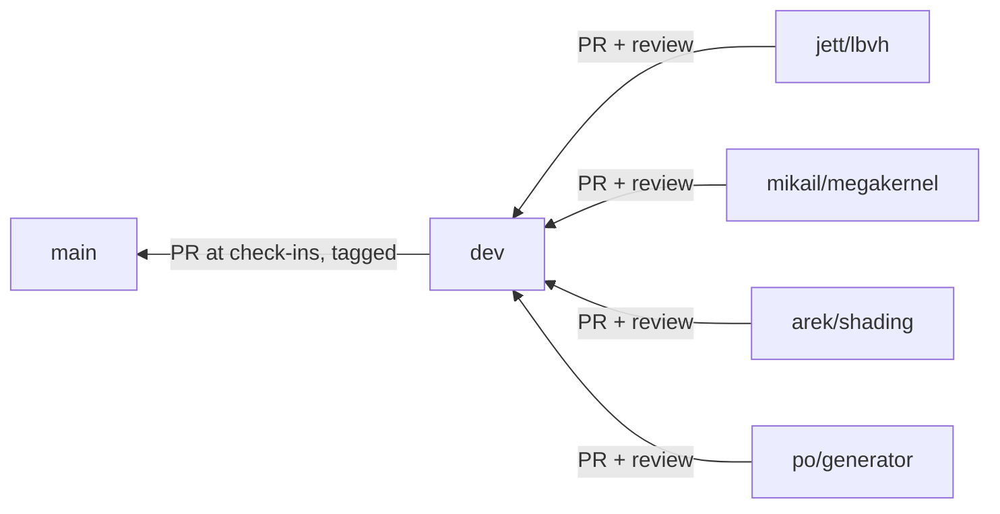

# Workflow

Kept deliberately light. The goal is that four people (and their agents) can work in parallel and merge without breaking each other. Anything heavier is listed under [Deferred](#deferred-process) and switched on only if a real problem shows up.

## Branches



| Branch | Protected | Receives | Rules |
|---|---|---|---|
| `main` | Yes | PRs from `dev` at check-ins | PR required with 1 approving review. No force-push, no deletion. Tagged `checkin-2`, `checkin-3`, `final` |
| `dev` | Partly | PRs or pushes from feature branches | No force-push, no deletion. A PR and review are expected, but not enforced yet |
| `<member>/<topic>` | No | Your commits | Branch from `dev`, keep short-lived |

GitHub enforces the `main` and `dev` rules for everyone except the repo admin (Mikail), who can push or merge directly. Teammates have write access, so they can't push to `main`. The `cpu` CI job is not a required check yet (see [Deferred](#deferred-process)).

### Working on a branch

One routine for everyone, so nobody has to choose between merge and rebase. **Merge `dev` into your branch. Never rebase or force-push a branch you've pushed.**

```bash
# one-time, per clone
git config pull.ff only                      # a plain `git pull` stops instead of making a surprise merge

# start a piece of work: always from the current dev, never from an old feature branch
git fetch origin
git switch -c jett/lbvh origin/dev

# ... edit, build, test, then commit (see Commit messages below) ...
git commit -s

# every few days, and before opening a PR: bring in dev
git fetch origin && git merge origin/dev     # then rebuild and run ctest before you push

# publish, then open a PR into dev
git push -u origin jett/lbvh

# after the PR is merged: clean up
git switch dev && git pull --ff-only && git branch -d jett/lbvh
```

- **One branch per piece of work**, named `<member>/<topic>` and short-lived. Small PRs (under about 400 lines) review faster.
- **PRs** target `dev`. Put `Closes #N` in the description so merging closes the issue, and check the CI result first (it is informational for now). Merge with a **merge commit**, not squash or rebase, so every signed-off commit is kept.
- **Never** force-push, rebase a pushed branch, or use `git reset --hard` to fix a problem. You can rebase commits you haven't pushed yet. GitHub rejects force-pushes to `dev` and `main`.
- **One writer per branch.** If two people must share one, run `git pull --ff-only` before every push.
- **Conflicts:** merge, fix the files, rebuild, test, then commit the merge. Ask the file's owner before resolving a conflict in their code, and always before touching INTERFACES.md.
- **If something looks wrong, stop and ask.** `git reflog` keeps your earlier commits, so nothing is lost.
- **Setup:** keep the clone inside the WSL filesystem ([BUILD.md](BUILD.md)), and leave `core.autocrlf` alone; `.gitattributes` handles line endings.
- Never commit generated `.bin` scenes, build directories, or large images.

## Stubs and local workarounds

You'll often need a stand-in because another owner's piece hasn't landed (the member files list what to use), or a local fix for a gap in someone else's code. That's fine, as long as it's tracked and short-lived. Otherwise stubs outlive their reason, or two definitions of the same type collide at merge.

1. **Put it somewhere obvious.** In a test file or a clearly named `*_stub.hpp`, and never under the real contract name. Don't edit the other owner's file to patch it locally; make the workaround in your own module.
2. **Mark it in the code**, once, at the definition:
   ```cpp
   // STUB(S3, jett): remove when AABB::empty() lands (#4)
   ```
   The format is `STUB(<ID>, <your name>): remove when <condition> lands (<issue>)`. The ID comes from the register.
3. **Add a row to the [Stub register](ROADMAP.md#stub-register)** in the same PR: ID, who uses it, where, what it stands in for, when to remove it. Use the next free ID. If the stub waits on a bug or gap in someone else's code, open (or comment on) an issue for the owner and link it.
4. **Remove it when the real thing lands.** The PR that adopts the real code deletes the stub, its marker, and its register row. If you land something others have stubbed, say so in your PR description and tell them; `git grep "STUB("` lists every user.
5. **CI checks the bookkeeping.** `scripts/ci/check_stubs.sh` runs on every PR. It lists the markers and fails when a marker has no ID or its ID has no register row. It only notes a register row with no marker, since a stub can live in a CMake file.

The weekly meeting reads the register (see [Routines](#routines)). At G1 and G2 it should hold no stub for a contract type (`Scene`, `Hit`, `Camera`, and so on) unless the row says why.

## Commit messages

Linux-kernel style, so `git log --oneline` reads like a changelog and each commit explains itself.

- **Subject:** `subsystem: imperative summary`. Keep it under about 72 characters, lowercase after the prefix, with no trailing period. The prefix names what the commit touches: a module (`core`, `scene`, `camera`, `bvh`, `trace`, `shade`, `cpu`, `gpu`, `bench`, `image`, `embree`, `optix`), `apps`, `tests`, `docs`, `scripts`, `ci`, or `repo` for root files (`.gitattributes`, `.clang-format`, CMake).
- **Body:** after a blank line, one or two short paragraphs wrapped at 72 columns. Say what changed and why, not a line-by-line list of the diff. Call out behavior or numeric changes and anything a reviewer should look at closely. A trivial change needs no body.
- **Sign-off:** every commit ends with `Signed-off-by: Name <email>`. Use `git commit -s`, which fills it in from `user.name` and `user.email`.
- **One logical change per commit.** Keep formatting and comment-only changes apart from logic changes so reviewers can skim them. Each commit should build and pass the tests on its own.
- **Not in commits:** deferred work and open questions belong in issues.
- **Optional trailers:** `Developed-on:` and `Needs-check:`, described in [Development environment](#development-environment).

```
core: add rt::Error and strengthen math tests

Add core/error.hpp with rt::Error, a std::runtime_error subclass for
host-side failures, as required by INTERFACES section 0.

Check every component of every vec3 operator in test_math.cpp, so a
swapped or mis-signed component is caught.

Signed-off-by: Jane Doe <jane@example.com>
```

## Development environment

The reference environments are the ones the toolchain is verified on (exact versions in [BUILD.md](BUILD.md#pinned-toolchain-pairs)):

| | Reference |
|---|---|
| Laptop | WSL2, Ubuntu 24.04, `g++-13` (GCC 13.x), the CUDA toolkit from the BUILD.md pinned pair (`nvcc`), x86_64 |
| Vista | GH node: Rocky Linux 9.7, aarch64, `module load gcc/13.2.0 cuda/13.3 cmake` |

"The laptop" in these docs is Mikail's machine (hardware in [BUILD.md](BUILD.md#toolchain-targets)). Nobody else is expected to have it. Set up your own machine to match its software as closely as you can:

- **Windows:** use WSL2 with Ubuntu 24.04 and the same tools (`g++-13`, `cmake`, `ninja-build`), following [BUILD.md](BUILD.md#laptop-wsl2-setup). Never build natively on Windows.
- **NVIDIA GPU:** install the same CUDA toolkit (the BUILD.md pinned pair) and set `RT_CUDA_ARCH` to your GPU's compute capability.
- **No NVIDIA GPU:** install the CUDA toolkit anyway if you can. `nvcc` compiles device code without a GPU, so you can still check that the CUDA build compiles; you just can't run kernels.

A machine set up this way counts as matching for builds and tests. Benchmark numbers come only from Mikail's laptop and Vista.

Other environments (native Windows, macOS, another Linux, a different GCC or CUDA version, no `nvcc`) can work, but results may differ. Float output depends on the compiler and on FMA contraction, and the device build may not be tested at all. So the rule is: **warn, don't block.**

**Check at the start of a session** (humans and agents), and again if the machine or toolchain changes:

```bash
grep -qi microsoft /proc/version && echo "WSL" || echo "not WSL"
. /etc/os-release && echo "$PRETTY_NAME"
hostname -f                                  # Vista: ends in .vista.tacc.utexas.edu
uname -m                                     # x86_64 on the laptop, aarch64 on Vista
g++-13 --version | head -1
nvcc --version | tail -2                     # "command not found": no CUDA here, or /usr/local/cuda-*/bin is not on PATH
```

The environment matches if it is WSL on Ubuntu 24.04 with `g++-13` and an `nvcc` release that matches BUILD.md, or a Vista GH node with the BUILD.md modules.

**If it doesn't match:**

1. Warn the user once, up front. Say what differs and what it could affect, for example "no `nvcc`: device code is not compiled here", "GCC 14: warnings and FMA contraction can differ", or "native Windows: not a supported build".
2. Keep going. Don't refuse to work, and don't install or change toolchains without asking.
3. Before opening a PR, verify the branch on Vista ([below](#verifying-on-vista)). This is recommended, not required. It matters most on macOS, where Apple Clang doesn't report some GCC 13 warnings and there is no CUDA, so neither the reference compiler nor the device build has run.
4. Add trailers to each commit made there:

```
Developed-on: macOS 15 (arm64), Apple clang 16, no CUDA
Needs-check: device build and FMA-sensitive tests on WSL or Vista
```

`Developed-on:` names the OS, compiler, and CUDA version (or "no CUDA"). `Needs-check:` lists what should be re-verified on a reference environment. Leave both out on a reference environment. A reviewer who sees them runs those checks on a reference environment before approving, which also covers the GPU checkbox in [Pull requests](#pull-requests).

### Verifying on Vista

From a `gh-dev` node (`idev -p gh-dev -N 1 -n 1 -t 1:00:00`, setup in [BUILD.md](BUILD.md#vista-setup)), in your clone under `$WORK`:

```bash
module reset && module load gcc/13.2.0 cuda/13.3 cmake
git fetch origin && git switch <member>/<topic> && git pull --ff-only
cmake -S . -B build-vista -DCMAKE_BUILD_TYPE=Release -DRT_ENABLE_CUDA=ON -DRT_CUDA_ARCH=90 -DCMAKE_CXX_COMPILER=g++
cmake --build build-vista -j 2>&1 | grep -E 'warning|error'    # expect no output
ctest --test-dir build-vista --output-on-failure
```

Record the result where the reviewer will see it:

- **Verified:** add a line to the PR description, for example `Verified on Vista: c642-061, commit abc1234, CUDA build, no warnings, ctest 30/30`. The reviewer can then skip the `Needs-check:` items it covers.
- **Not verified:** the trailers stay as they are. The `Needs-check:` on the branch's last commit must list everything still unchecked, so the reviewer knows what to run.

## Pull requests

PR description (template in [`.github/pull_request_template.md`](../.github/pull_request_template.md)): what and why, tests added, and these checkboxes:

- **GPU checked?** If you changed render code (`core`, `trace`, `shade`, `bvh`, `camera`, `gpu`) **and** a GPU path exists on `dev`, build with CUDA and run the GPU vs CPU comparison on a known scene. Paste the `rt_compare` summary. Before any GPU path exists, a CUDA build that compiles is enough.
- **Interface change?** If the PR edits [INTERFACES.md](INTERFACES.md), see [Interface changes](#interface-changes).
- **Stubs?** If the PR adds, changes, or removes a stub or workaround, the [register](ROADMAP.md#stub-register) is updated in the same PR (see [Stubs and local workarounds](#stubs-and-local-workarounds)).
- **Development environment?** If it wasn't a reference environment, the commits carry the `Developed-on:` / `Needs-check:` trailers. If you then [verified on Vista](#verifying-on-vista), say so in the description.

Review: one approval from someone other than the author, ideally the owner of the code you're calling. Reviewers check correctness, tests, and that the interfaces are respected. Formatting is automatic (`.clang-format`). Try to review within a day.

## Interface changes

INTERFACES.md is what lets everyone's parts slot together, so it's the one place with a stricter rule:

1. Open a PR that changes INTERFACES.md and the code together.
2. Every owner whose code is affected approves it (usually 1–2 people, not all four).
3. Bump the version line at the top of INTERFACES.md, and tell the team chat.

Small clarifications that don't change any type, signature, or numeric rule only need the normal single review.

## CI

GitHub Actions, CPU only (no GPU runners). Owner: Mikail. The workflow has one job, `cpu`, which runs on every PR and push to `dev` and `main`. It is informational for now: merging doesn't wait for it, so check the result before you merge. Steps:

1. Build with `-DRT_ENABLE_CUDA=OFF` (GCC 13).
2. Run all `ctest` tests that exist. Tests get added as features land; nothing is required before it exists.
3. `clang-format --dry-run --Werror` on changed files.

Golden-image tests are ordinary `ctest` cases: render a known scene, then `rt_compare` it against a committed golden **with the normal tolerances**. They're added when shading lands (around G1).

## Checkpoints and check-ins

Gates G0–G3 in [ROADMAP.md](ROADMAP.md#gates-and-schedule) are team checkpoints, discussed at the weekly meeting, not formal freezes. Before G1 and G2, check that the [stub register](ROADMAP.md#stub-register) holds no stub for a contract type unless its row explains why. Only the instructor check-ins go to `main`:

1. Agree on a `dev` commit that builds and passes tests on the laptop and Vista.
2. PR `dev` → `main`, quick whole-team look.
3. Tag it (`checkin-2`, `checkin-3`, `final`).

## Issues

One GitHub issue per task in [ROADMAP.md](ROADMAP.md), assigned to its owner. Labels: `area:*` (bvh, gpu, shading, cpu, scene, infra, bench), `core` / `extension`, `interface`, `blocked`, `bug`.

## Routines

- **Weekly meeting** (~30 min): done / next / blocked, plus any interface questions. Jett updates the [status table](ROADMAP.md#status). Read the [stub register](ROADMAP.md#stub-register): every open row needs an owner and a removal condition, and rows marked `ready to remove` get removed that week.
- **Contribution log**: one row per week at the bottom of your [member file](members/). It feeds the report, as the proposal requires.
- **Blocked more than a day?** Use the stub listed in your member file, label the issue `blocked`, and say so in chat.

## Deferred process

These were considered and deliberately **not** adopted now. Turn one on only if the problem it solves actually happens.

| Deferred | Turn on if |
|---|---|
| Required `cpu` CI check on `main` (and on `dev`), and required PR plus review on `dev` | A broken or badly formatted change reaches `dev` or `main`, or the team grows past one regular reviewer. Set it in the repo's branch protection settings; the status check name is the job name `cpu` in `.github/workflows/ci.yml` |
| Exact (bit-identical) goldens in a pinned CI container ([BUILD.md](BUILD.md#golden-image-environment-deferred)) | Tolerance-based goldens miss a real regression |
| CI phases, golden registry, and a "ratchet" rule for removing tests | Tests get disabled to make PRs pass |
| All-four approval for every interface edit | Interface changes start breaking people's code |
| Feature freezes and `main` tags at every gate | A check-in build turns out broken |
| Full corruption-test suite for `rt_compare` ([BENCHMARKING.md](BENCHMARKING.md#deferred-comparison-hardening)) | A visibly wrong image passes `rt_compare` |
