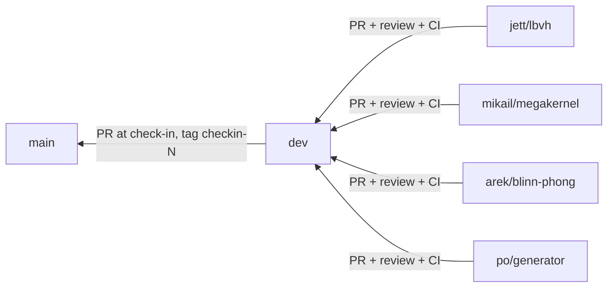

# Workflow

Git branching, pull requests, CI, issues, and team routines.

## Branches



| Branch | Protected | Receives | Rules |
|---|---|---|---|
| `main` | Yes | PRs from `dev` only, at gates and check-ins | Tagged `g0` … `g3`, `checkin-2`, `checkin-3`, `final` |
| `dev` | Yes | PRs from feature branches | ≥ 1 approving review, CPU CI green, GPU checkbox for rendering changes |
| `<member>/<topic>` | No | Your commits | Branch from `dev`, keep short-lived |

Branch names: lowercase first name + topic, e.g. `jett/lbvh`, `mikail/mem-modes`, `arek/blinn-phong`, `po/generator`.

Day to day:

```bash
git switch dev && git pull
git switch -c jett/lbvh
# ... work, commit ...
git fetch origin && git rebase origin/dev     # or: git merge origin/dev
git push -u origin jett/lbvh
# open PR into dev
```

- Sync with `dev` at least every few days. Small PRs (< ~400 lines) merge faster.
- Don't force-push to `dev` or `main`. Force-pushing your own feature branch after a rebase is fine.
- Never commit generated `.bin` scenes, build directories, or large images.

## Pull requests

PR template contents (file text in [REPO_SKELETON.md](REPO_SKELETON.md#pr-template)):

- **Summary**: what and why.
- **Area**: bvh / gpu / shading / cpu / scene / infra / bench / docs.
- **Tests added or updated.**
- **CPU CI**: green (automatic).
- **GPU check** for PRs that change rendering code (`core`, `trace`, `shade`, `bvh`, `camera`, `gpu`). What's required depends on whether the CUDA megakernel (C10) has merged to `dev`:

  | Phase | Required GPU evidence |
  |---|---|
  | **Before C10 merges** | CPU CI green (unit tests + CPU goldens). A CUDA build with `-DRT_ENABLE_CUDA=ON` compiles on the laptop or Vista, so `RT_HOSTDEV` code still compiles under nvcc. Run `hello_cuda` / available CUDA smoke tests. No GPU image comparison, because none exists yet. |
  | **After C10 merges** | All of the above, plus `rt_compare` of GPU vs CPU on the known-case scenes (and `bench_100k` for traversal, BVH, or shading changes), with the output pasted in the PR. |

  The switch happens automatically when C10 lands. Mikail announces it in the team chat.
- **Performance impact**: before/after numbers if relevant.
- **Contract change?** y/n. If yes: the author signs off in the PR, and all three other members must approve the review (GitHub authors can't approve their own PRs). See [INTERFACES.md](INTERFACES.md#contract-change-process).

Review rules:

- At least one approval from someone other than the author. Prefer the owner of the area being touched.
- Reviewers check correctness, tests, and contract compliance. Style is handled by `.clang-format`.
- Respond to reviews within ~1 day. Don't let PRs sit.
- `dev` → `main` PRs at each check-in are reviewed by the whole team in the check-in prep meeting.

## CI

GitHub Actions, CPU-only build (no GPU runners). Owner: Mikail.

On every PR and push to `dev`/`main`:

1. Configure with `-DRT_ENABLE_CUDA=OFF`, build with GCC 13.
2. Run unit tests (`ctest`).
3. Render known-case scenes on CPU and compare with committed golden images via `rt_compare`.
4. `clang-format --dry-run --Werror` on changed files.

GPU checks run manually (laptop or TACC) and are recorded in the PR. Outline in [REPO_SKELETON.md](REPO_SKELETON.md#ci-workflow-outline).

## Issues

Every Core task (C1–C14) in [ROADMAP.md](ROADMAP.md) becomes a GitHub issue, assigned to its owner and linked to a gate milestone (G0–G3, final). Extensions (E1–E6) get issues too.

| Label | Use |
|---|---|
| `area:bvh`, `area:gpu`, `area:shading`, `area:cpu`, `area:scene`, `area:infra`, `area:bench` | Code area |
| `core`, `extension`, `stretch` | Scope tier ([ROADMAP.md](ROADMAP.md#scope)). Extension issues stay unassigned until their gate passes |
| `contract` | Touches [INTERFACES.md](INTERFACES.md) |
| `blocked` | Waiting on another issue (link it) |
| `bug` | Defect |

## Gates and check-ins

At each gate (G0 Oct 30, G1 Nov 6, G2 Nov 13, G3 Nov 18) and before each check-in:

1. Stop feature merges on `dev` the day before.
2. Run the full test suite, plus a GPU `rt_compare` check on both machines from G2 on.
3. Open a `dev` → `main` PR for whole-team review against the gate's exit criteria in [ROADMAP.md](ROADMAP.md#gates-and-schedule).
4. Tag `main` (`g0` … `g3`, `checkin-N`). Instructors and the report reference these tags.

A gate that misses its criteria is recorded as missed in the status table. Don't redefine it.

## Routines

- **Weekly team meeting** (~30 min): each person reports done / next / blocked. Jett updates milestone status in [ROADMAP.md](ROADMAP.md).
- **Weekly contribution log**: each member adds one row per week to the log at the bottom of their [member file](members/). Link PRs and issues. This feeds the report's contribution section, as the proposal requires.
- **Blocked > 2 days?** Switch to the relevant stub from [ROADMAP.md](ROADMAP.md#stubs), label the issue `blocked`, and raise it in the team chat.
