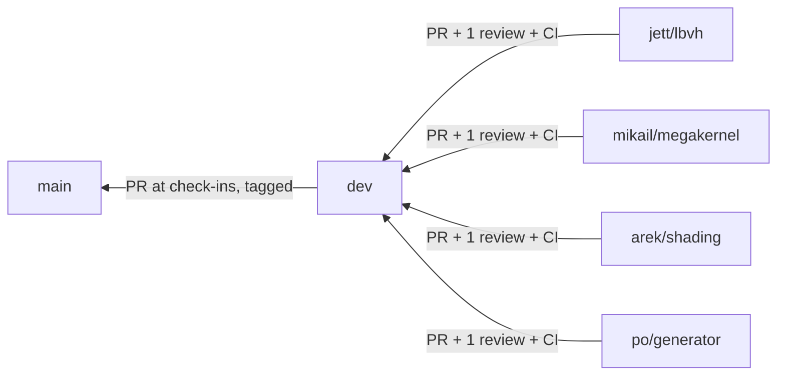

# Workflow

Kept deliberately light. The goal is that four people (and their agents) can work in parallel and merge without breaking each other. Anything heavier is listed under [Deferred](#deferred-process) and switched on only if a real problem shows up.

## Branches



| Branch | Protected | Receives | Rules |
|---|---|---|---|
| `main` | Yes | PRs from `dev` at check-ins | Tagged `checkin-2`, `checkin-3`, `final` |
| `dev` | Yes | PRs from feature branches | 1 approving review, CI green |
| `<member>/<topic>` | No | Your commits | Branch from `dev`, keep short-lived |

```bash
git switch dev && git pull
git switch -c jett/lbvh
# ... work, commit ...
git fetch origin && git rebase origin/dev     # or: git merge origin/dev
git push -u origin jett/lbvh                  # then open a PR into dev
```

- Sync with `dev` every few days. Small PRs (< ~400 lines) review faster.
- Don't force-push `dev` or `main`.
- Never commit generated `.bin` scenes, build directories, or large images.

## Pull requests

PR description (template in [REPO_SKELETON.md](REPO_SKELETON.md#pr-template)): what and why, tests added, and two checkboxes:

- **GPU checked?** If you changed render code (`core`, `trace`, `shade`, `bvh`, `camera`, `gpu`) **and** a GPU path exists on `dev`, build with CUDA and run the GPU vs CPU comparison on a known scene. Paste the `rt_compare` summary. Before any GPU path exists, a CUDA build that compiles is enough.
- **Interface change?** If the PR edits [INTERFACES.md](INTERFACES.md), see [Interface changes](#interface-changes).

Review: one approval from someone other than the author, ideally the owner of the code you're calling. Reviewers check correctness, tests, and that the interfaces are respected. Formatting is automatic (`.clang-format`). Try to review within a day.

## Interface changes

INTERFACES.md is what lets everyone's parts slot together, so it's the one place with a stricter rule:

1. Open a PR that changes INTERFACES.md and the code together.
2. Every owner whose code is affected approves it (usually 1–2 people, not all four).
3. Bump the version line at the top of INTERFACES.md, and tell the team chat.

Small clarifications that don't change any type, signature, or numeric rule only need the normal single review.

## CI

GitHub Actions, CPU only (no GPU runners). Owner: Mikail. On every PR to `dev`:

1. Build with `-DRT_ENABLE_CUDA=OFF` (GCC 13).
2. Run all `ctest` tests that exist. Tests get added as features land; nothing is required before it exists.
3. `clang-format --dry-run --Werror` on changed files.

Golden-image tests are ordinary `ctest` cases: render a known scene, then `rt_compare` it against a committed golden **with the normal tolerances**. They're added when shading lands (around G1).

## Checkpoints and check-ins

Gates G0–G3 in [ROADMAP.md](ROADMAP.md#gates-and-schedule) are team checkpoints, discussed at the weekly meeting, not formal freezes. Only the instructor check-ins go to `main`:

1. Agree on a `dev` commit that builds and passes tests on the laptop and Vista.
2. PR `dev` → `main`, quick whole-team look.
3. Tag it (`checkin-2`, `checkin-3`, `final`).

## Issues

One GitHub issue per task in [ROADMAP.md](ROADMAP.md), assigned to its owner. Labels: `area:*` (bvh, gpu, shading, cpu, scene, infra, bench), `core` / `extension`, `interface`, `blocked`, `bug`.

## Routines

- **Weekly meeting** (~30 min): done / next / blocked, plus any interface questions. Jett updates the [status table](ROADMAP.md#status).
- **Contribution log**: one row per week at the bottom of your [member file](members/). It feeds the report, as the proposal requires.
- **Blocked more than a day?** Use the stub listed in your member file, label the issue `blocked`, and say so in chat.

## Deferred process

These were considered and deliberately **not** adopted now. Turn one on only if the problem it solves actually happens.

| Deferred | Turn on if |
|---|---|
| Exact (bit-identical) goldens in a pinned CI container ([BUILD.md](BUILD.md#golden-image-environment-deferred)) | Tolerance-based goldens miss a real regression |
| CI phases, golden registry, and a "ratchet" rule for removing tests | Tests get disabled to make PRs pass |
| All-four approval for every interface edit | Interface changes start breaking people's code |
| Feature freezes and `main` tags at every gate | A check-in build turns out broken |
| Full corruption-test suite for `rt_compare` ([BENCHMARKING.md](BENCHMARKING.md#deferred-comparison-hardening)) | A visibly wrong image passes `rt_compare` |
