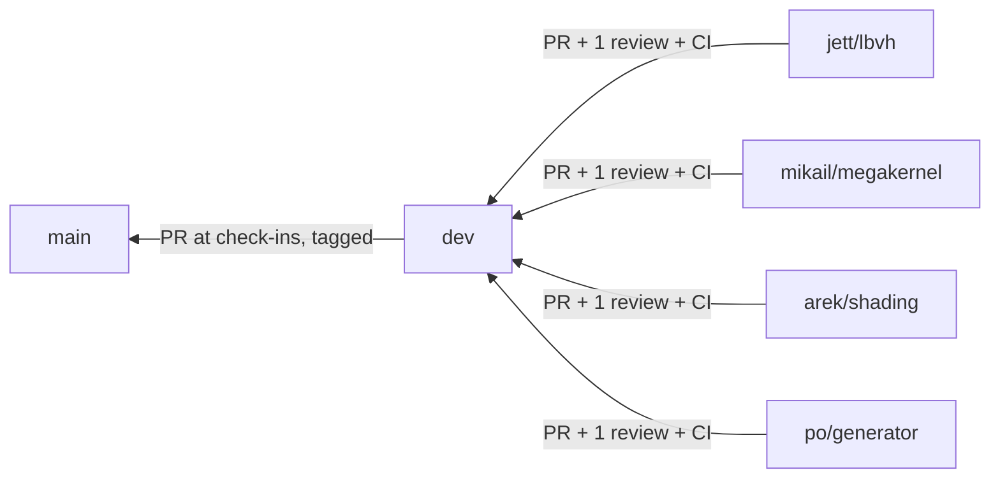

# Workflow

Kept deliberately light. The goal is that four people (and their agents) can work in parallel and merge without breaking each other. Anything heavier is listed under [Deferred](#deferred-process) and switched on only if a real problem shows up.

## Branches



| Branch | Protected | Receives | Rules |
|---|---|---|---|
| `main` | Yes | PRs from `dev` at check-ins | PR required with 1 approving review. No force-push, no deletion. Tagged `checkin-2`, `checkin-3`, `final` |
| `dev` | Partly | PRs or pushes from feature branches | No force-push, no deletion. A PR and review are expected, but not enforced yet |
| `<member>/<topic>` | No | Your commits | Branch from `dev`, keep short-lived |

GitHub enforces the `main` and `dev` rules for everyone except the repo admin (Mikail), who can push or merge directly. Teammates have write access, so they can't push to `main`. The `cpu` CI job is not a required check yet (see [Deferred](#deferred-process)).

```bash
git switch dev && git pull
git switch -c jett/lbvh
# ... work, commit ...
git fetch origin && git rebase origin/dev     # or: git merge origin/dev
git push -u origin jett/lbvh                  # then open a PR into dev
```

- Sync with `dev` every few days. Small PRs (< ~400 lines) review faster.
- Don't force-push `dev` or `main`.
- Never commit generated `.bin` scenes, build directories, or large images.

## Commit messages

Linux-kernel style, so `git log --oneline` reads like a changelog and each commit explains itself.

- **Subject:** `subsystem: imperative summary`. Keep it under about 72 characters, lowercase after the prefix, with no trailing period. The prefix names what the commit touches: a module (`core`, `scene`, `camera`, `bvh`, `trace`, `shade`, `cpu`, `gpu`, `bench`, `image`, `embree`, `optix`), `apps`, `tests`, `docs`, `scripts`, `ci`, or `repo` for root files (`.gitattributes`, `.clang-format`, CMake).
- **Body:** after a blank line, one or two short paragraphs wrapped at 72 columns. Say what changed and why, not a line-by-line list of the diff. Call out behavior or numeric changes and anything a reviewer should look at closely. A trivial change needs no body.
- **Sign-off:** every commit ends with `Signed-off-by: Name <email>`. Use `git commit -s`, which fills it in from `user.name` and `user.email`.
- **One logical change per commit.** Keep formatting and comment-only changes apart from logic changes so reviewers can skim them. Each commit should build and pass the tests on its own.
- **Not in commits:** deferred work and open questions belong in issues.
- **Optional trailers:** `Developed-on:` and `Needs-check:`, described in [Development environment](#development-environment).

```
core: add rt::Error and strengthen math tests

Add core/error.hpp with rt::Error, a std::runtime_error subclass for
host-side failures, as required by INTERFACES section 0.

Check every component of every vec3 operator in test_math.cpp, so a
swapped or mis-signed component is caught.

Signed-off-by: Jane Doe <jane@example.com>
```

## Development environment

The reference environments are the ones the toolchain is verified on (exact versions in [BUILD.md](BUILD.md#pinned-toolchain-pairs)):

| | Reference |
|---|---|
| Laptop | WSL2, Ubuntu 24.04, `g++-13` (GCC 13.x), the CUDA toolkit from the BUILD.md pinned pair (`nvcc`), x86_64 |
| Vista | GH node: Rocky Linux 9.7, aarch64, `module load gcc/13.2.0 cuda/13.3 cmake` |

Other environments (native Windows, macOS, another Linux, a different GCC or CUDA version, no `nvcc`) can work, but results may differ. Float output depends on the compiler and on FMA contraction, and the device build may not be tested at all. So the rule is: **warn, don't block.**

**Check at the start of a session** (humans and agents), and again if the machine or toolchain changes:

```bash
grep -qi microsoft /proc/version && echo "WSL" || echo "not WSL"
. /etc/os-release && echo "$PRETTY_NAME"
hostname -f                                  # Vista: ends in .vista.tacc.utexas.edu
uname -m                                     # x86_64 on the laptop, aarch64 on Vista
g++-13 --version | head -1
nvcc --version | tail -2                     # "command not found": no CUDA here, or /usr/local/cuda-*/bin is not on PATH
```

The environment matches if it is WSL on Ubuntu 24.04 with `g++-13` and an `nvcc` release that matches BUILD.md, or a Vista GH node with the BUILD.md modules.

**If it doesn't match:**

1. Warn the user once, up front. Say what differs and what it could affect, for example "no `nvcc`: device code is not compiled here", "GCC 14: warnings and FMA contraction can differ", or "native Windows: not a supported build".
2. Keep going. Don't refuse to work, and don't install or change toolchains without asking.
3. Encourage the user to do final verification on WSL Ubuntu 24.04 or Vista.
4. Add trailers to each commit made there:

```
Developed-on: macOS 15 (arm64), Apple clang 16, no CUDA
Needs-check: device build and FMA-sensitive tests on WSL or Vista
```

`Developed-on:` names the OS, compiler, and CUDA version (or "no CUDA"). `Needs-check:` lists what should be re-verified on a reference environment. Leave both out on a reference environment. A reviewer who sees them runs those checks on a reference environment before approving, which also covers the GPU checkbox in [Pull requests](#pull-requests).

## Pull requests

PR description (template in [REPO_SKELETON.md](REPO_SKELETON.md#pr-template)): what and why, tests added, and two checkboxes:

- **GPU checked?** If you changed render code (`core`, `trace`, `shade`, `bvh`, `camera`, `gpu`) **and** a GPU path exists on `dev`, build with CUDA and run the GPU vs CPU comparison on a known scene. Paste the `rt_compare` summary. Before any GPU path exists, a CUDA build that compiles is enough.
- **Interface change?** If the PR edits [INTERFACES.md](INTERFACES.md), see [Interface changes](#interface-changes).

Review: one approval from someone other than the author, ideally the owner of the code you're calling. Reviewers check correctness, tests, and that the interfaces are respected. Formatting is automatic (`.clang-format`). Try to review within a day.

## Interface changes

INTERFACES.md is what lets everyone's parts slot together, so it's the one place with a stricter rule:

1. Open a PR that changes INTERFACES.md and the code together.
2. Every owner whose code is affected approves it (usually 1–2 people, not all four).
3. Bump the version line at the top of INTERFACES.md, and tell the team chat.

Small clarifications that don't change any type, signature, or numeric rule only need the normal single review.

## CI

GitHub Actions, CPU only (no GPU runners). Owner: Mikail. The workflow has one job, `cpu`, which runs on every PR and push to `dev` and `main`. It is informational for now: merging doesn't wait for it, so check the result before you merge. Steps:

1. Build with `-DRT_ENABLE_CUDA=OFF` (GCC 13).
2. Run all `ctest` tests that exist. Tests get added as features land; nothing is required before it exists.
3. `clang-format --dry-run --Werror` on changed files.

Golden-image tests are ordinary `ctest` cases: render a known scene, then `rt_compare` it against a committed golden **with the normal tolerances**. They're added when shading lands (around G1).

## Checkpoints and check-ins

Gates G0–G3 in [ROADMAP.md](ROADMAP.md#gates-and-schedule) are team checkpoints, discussed at the weekly meeting, not formal freezes. Only the instructor check-ins go to `main`:

1. Agree on a `dev` commit that builds and passes tests on the laptop and Vista.
2. PR `dev` → `main`, quick whole-team look.
3. Tag it (`checkin-2`, `checkin-3`, `final`).

## Issues

One GitHub issue per task in [ROADMAP.md](ROADMAP.md), assigned to its owner. Labels: `area:*` (bvh, gpu, shading, cpu, scene, infra, bench), `core` / `extension`, `interface`, `blocked`, `bug`.

## Routines

- **Weekly meeting** (~30 min): done / next / blocked, plus any interface questions. Jett updates the [status table](ROADMAP.md#status).
- **Contribution log**: one row per week at the bottom of your [member file](members/). It feeds the report, as the proposal requires.
- **Blocked more than a day?** Use the stub listed in your member file, label the issue `blocked`, and say so in chat.

## Deferred process

These were considered and deliberately **not** adopted now. Turn one on only if the problem it solves actually happens.

| Deferred | Turn on if |
|---|---|
| Required `cpu` CI check on `main` (and on `dev`), and required PR plus review on `dev` | A broken or badly formatted change reaches `dev` or `main`, or the team grows past one regular reviewer. Set it in the repo's branch protection settings; the status check name is the job name `cpu` in `.github/workflows/ci.yml` |
| Exact (bit-identical) goldens in a pinned CI container ([BUILD.md](BUILD.md#golden-image-environment-deferred)) | Tolerance-based goldens miss a real regression |
| CI phases, golden registry, and a "ratchet" rule for removing tests | Tests get disabled to make PRs pass |
| All-four approval for every interface edit | Interface changes start breaking people's code |
| Feature freezes and `main` tags at every gate | A check-in build turns out broken |
| Full corruption-test suite for `rt_compare` ([BENCHMARKING.md](BENCHMARKING.md#deferred-comparison-hardening)) | A visibly wrong image passes `rt_compare` |
